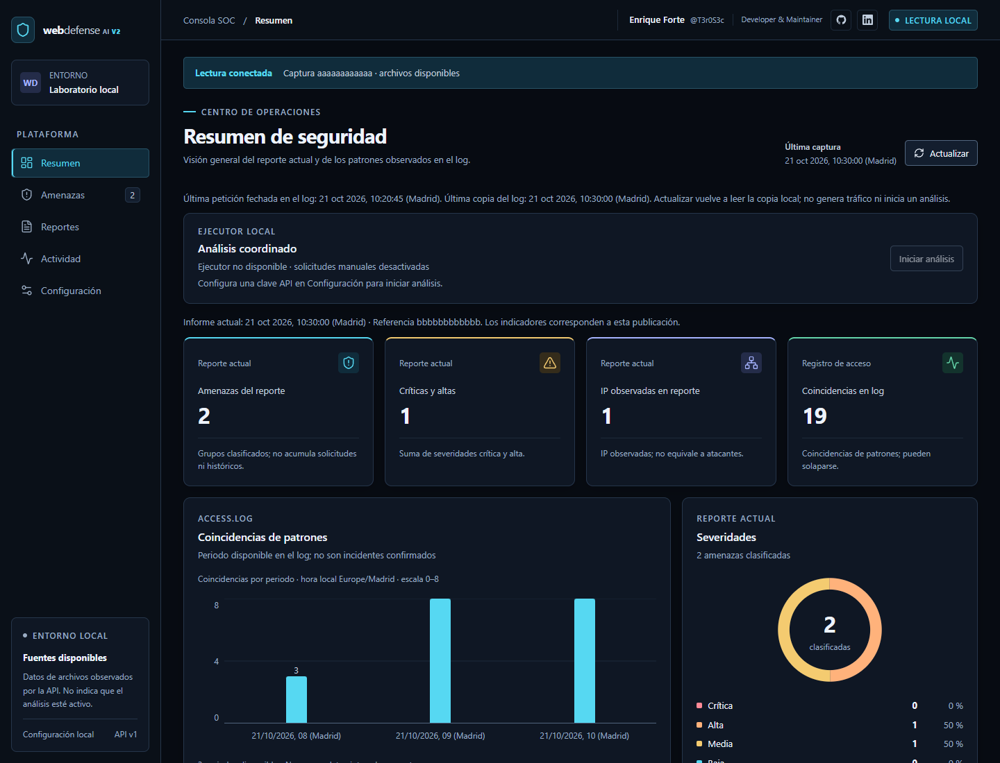
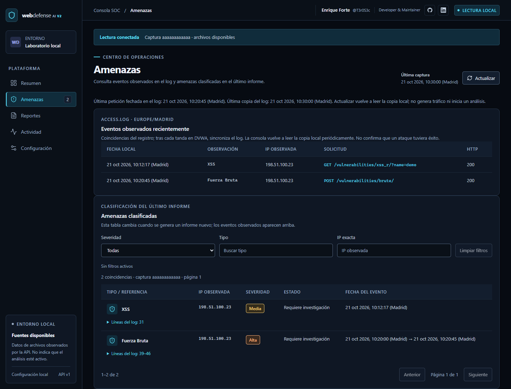
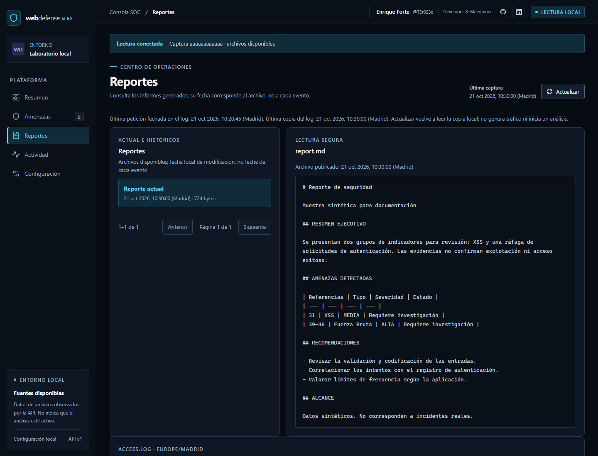
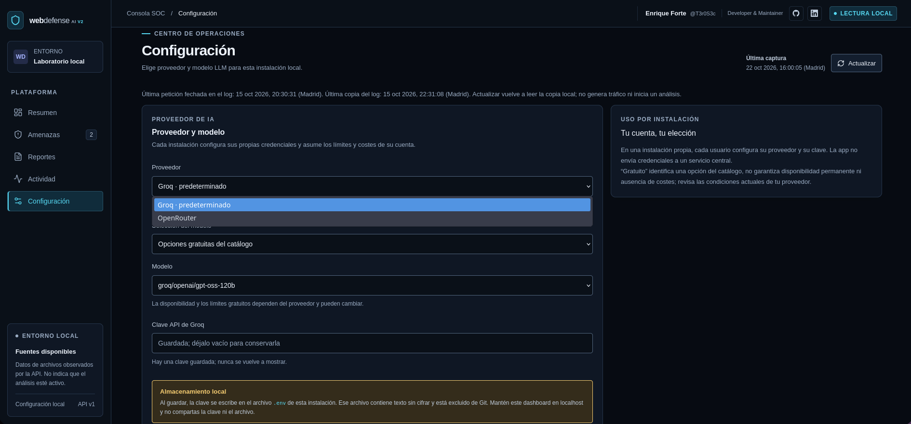
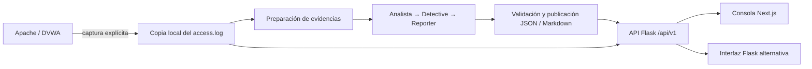

<div align="center">

# 🛡️ Web Defense AI · V2

**Del registro de acceso a la evidencia: análisis defensivo con agentes de IA.**

Consola local para revisar actividad de Apache, investigar patrones sospechosos
y consultar informes con referencias a las líneas del log.

[](https://github.com/EnriqueForte/web-defense-ai-v2/releases/tag/v0.1.0)


[](LICENSE)

[Inicio rápido](#inicio-rápido) · [Consola](#la-consola) · [Arquitectura](#arquitectura) · [Documentación](#documentación)

</div>



*Resumen con datos sintéticos de demostración; no representa incidentes reales ni una nueva ejecución del modelo.*

## Qué hace

Web Defense AI combina preparación de evidencias en Python, tres agentes CrewAI
y una consola de revisión. Está pensado para **laboratorios, aprendizaje y apoyo
al análisis defensivo local**: permite pasar de las peticiones del registro a un
informe trazable, manteniendo visible la diferencia entre un patrón observado y
un incidente confirmado.

- **Revisa indicadores:** patrones de SQLi, XSS, traversal, fuerza bruta e inyección de comandos, sujetos a la evidencia disponible.
- **Agrupa hallazgos:** presenta tipo, severidad, IP observada y referencias al log; varios intentos pueden formar un único grupo.
- **Consulta informes:** accede al reporte actual y a los archivos históricos disponibles, con fechas de publicación y lectura segura como texto.
- **Explora la actividad:** muestra coincidencias por periodo y una ventana de peticiones recientes.
- **Controla la ejecución:** separa la lectura de datos, el análisis y las notificaciones opcionales.

V2 continúa el [proyecto original Web Defense AI](https://github.com/EnriqueForte/web-defense-ai)
de **T3r0S3c**, con una interfaz Next.js, API versionada, publicaciones estructuradas
y herramientas de instalación y recuperación. Ambos repositorios se mantienen
independientes; consulta [su relación y alcance](docs/REPOSITORIOS.md).

### Distribución pública

El código está disponible en un **repositorio público de GitHub bajo licencia
MIT**, para consulta, clonación e instalación propias sin solicitar acceso.
La apertura y sus comprobaciones se registran en [Distribución pública](docs/DISTRIBUCION_PUBLICA.md).
Cada instalación mantiene sus propias credenciales, logs e informes.
La consola y el laboratorio siguen destinados al uso local aislado.

## La consola

Cinco vistas organizan el trabajo: **Resumen**, **Amenazas**, **Reportes**,
**Actividad** y **Configuración**. El resumen reúne indicadores y severidades;
el detalle permite contrastar los grupos del informe con sus evidencias.

| Amenazas y referencias | Consulta de informes |
| :---: | :---: |
| [](screenshots/v2-threats.png) | [](screenshots/v2-reports.png) |

*Pulsa una imagen para ampliarla. [Procedencia de las capturas](screenshots/README.md).*

Las **coincidencias del log** y los **grupos clasificados del informe** son
medidas distintas. La actividad reciente es una ventana de ocho líneas de la
API, no un registro histórico completo. **Actualizar** relee la copia local:
no captura tráfico nuevo ni solicita un análisis.

### Configuración del LLM

Selecciona **Groq u OpenRouter**, elige un modelo del catálogo o introduce otro
identificador compatible y configura tus credenciales desde la consola.
Cada instalación conserva su propia configuración local; guardar no valida
la clave ni inicia un análisis. [Guía de configuración LLM](docs/CONFIGURACION_PROVEEDOR_LLM.md).

[](screenshots/v2-llm.png)

*Captura aportada por el propietario el 22/10/2026. El campo de clave está vacío y no muestra la credencial guardada.*

## Inicio rápido

### Requisitos

| Herramienta | Versión / uso |
| --- | --- |
| Git | Clonar el repositorio público por HTTPS, sin token de GitHub |
| Python | **3.11**, con `venv` y `ensurepip` |
| Node.js | **24 o posterior** |
| pnpm | **11.19.0** |
| Docker | Opcional; solo para el laboratorio DVWA/Mailpit |

### Instalar e iniciar

En Linux, desde la carpeta donde quieras clonar:

```bash
git clone https://github.com/EnriqueForte/web-defense-ai-v2.git
cd web-defense-ai-v2
python3 webdefense.py install
python3 webdefense.py start --mode structured
```

En Windows, tras clonar y entrar en la carpeta:

```powershell
py webdefense.py install
py webdefense.py start --mode structured
```

Cuando aparezca **«Consola lista»**, abre **[http://127.0.0.1:3000](http://127.0.0.1:3000)**.
Mantén la terminal abierta; **Ctrl+C detiene Flask y Next.js** iniciados por el
lanzador. En una VM, abre la dirección desde el navegador de esa VM.

El instalador prepara `.p2`, comprueba las dependencias fijadas y compila el
frontend. Crea `.env` si falta y conserva uno existente. No necesitas activar
el entorno virtual para usar el lanzador.

Este inicio abre la consola **en modo de lectura**, sin worker, análisis manual
ni notificaciones habilitados. Una instalación nueva puede indicar «Fuentes
incompletas»: cada usuario aporta sus logs y publicaciones. Para configurar el
proveedor y ejecutar un análisis, sigue la [guía de instalación y operación](docs/INSTALACION_AUTOALOJADA.md).

Se muestra `--mode structured` para consultar publicaciones estructuradas de V2.
El modo predeterminado del lanzador sigue siendo `legacy`; utiliza
`--mode legacy` para los informes anteriores. Elegir modo no genera un informe.

Consulta [Inicio rápido](docs/INICIO_RAPIDO.md) para preparar las herramientas,
comprobar el entorno y resolver problemas de arranque.

## Arquitectura



En modo **structured**, Python selecciona evidencia, valida referencias y
clasificación, calcula tablas y conteos y publica una generación coherente de
JSON/Markdown. Los tres agentes participan en el análisis; la publicación pasa
por validaciones antes de quedar disponible para la consola. El ejecutor de
análisis se inicia por separado del lanzador de lectura.

| Componente | Tecnología |
| --- | --- |
| Motor de análisis | Python 3.11 · CrewAI 1.15.27 · contrato de 172 paquetes por plataforma |
| Proveedores LLM | Groq predeterminado · OpenRouter opcional · credenciales propias |
| Consola | Next.js 16 · React 19 · TypeScript |
| API e interfaz alternativa | Flask · API `/api/v1` |
| Laboratorio opcional | DVWA · MariaDB · Mailpit, con imágenes fijadas por digest |
| Avisos opcionales | Telegram / SMTP, mediante configuración y ejecución explícitas |

El laboratorio recomendado utiliza **`compose.lab.yaml`**, con puertos publicados
en loopback. `docker-compose.yml` conserva el entorno legacy y tiene una
exposición diferente. Antes de actualizar un laboratorio existente, sigue las
instrucciones de respaldo de la [guía DVWA](docs/LABORATORIO_DVWA_FASE_6.md):
la copia de la aplicación no incluye el volumen de la base ni el buzón Mailpit.

## Documentación

| Para… | Consulta |
| --- | --- |
| Instalar y abrir la consola | [Inicio rápido](docs/INICIO_RAPIDO.md) |
| Preparar logs y ejecutar análisis | [Instalación y operación](docs/INSTALACION_AUTOALOJADA.md) |
| Elegir proveedor y configurar credenciales | [Configuración LLM](docs/CONFIGURACION_PROVEEDOR_LLM.md) |
| Trabajar con un laboratorio aislado | [DVWA y Mailpit](docs/LABORATORIO_DVWA_FASE_6.md) |
| Conservar y recuperar datos | [Operación y recuperación](docs/OPERACION_RECUPERACION_2026_10_14.md) |
| Desarrollar y consultar el plan | [Guía de VSCode](docs/GUIA_VSCODE.md) · [Plan del proyecto](docs/PLAN_AGENTES_TAREAS.md) |
| Revisar la entrega y su validación | [Notas de versión](docs/NOTAS_VERSION_LOCAL_2026_10_20.md) · [Estado vigente](docs/ESTADO_FINAL_2026_10_12.md) |

### Versión y validación

La primera entrega local es **[v0.1.0](https://github.com/EnriqueForte/web-defense-ai-v2/releases/tag/v0.1.0)**.
El código de entrega pasó instalación, regresión, pruebas de interfaz y recorrido
API/proxy en [CI Windows y Ubuntu](https://github.com/EnriqueForte/web-defense-ai-v2/actions/runs/39466610699).
La actualización, recuperación aislada y lectura/cierre en Parrot se documentan
en el [registro V1](docs/ACTUALIZACION_PARROT_V1_2026_10_20.md).

La aceptación cubre el uso local de apoyo a la revisión de indicadores.
Los [criterios y límites de evaluación](docs/MATRIZ_ACEPTACION_A05_2026_10_20.md)
y el [tratamiento de riesgos](docs/TRATAMIENTO_RIESGOS_C3_2026_10_20.md)
conservan el detalle. Los [estados anteriores del README](docs/HISTORIAL_README_2026_10_20.md)
se mantienen como referencia histórica.

## Uso responsable y límites

- **Evidencia, no confirmación automática.** Un patrón, un HTTP 200 o una petición a un avatar no demuestran explotación ni autenticación exitosa. Las IP mostradas son observadas; no identifican por sí solas a un atacante.
- **Alcance local.** Mantén la consola en localhost y DVWA aislado. No se ofrece remediación automática, uso público multiusuario ni soporte general de todas las plataformas.
- **Privacidad y costes.** Un análisis puede enviar contenido del log al proveedor elegido. La clave se guarda en `.env` local, sin cifrar y excluido de Git; guardar la configuración no valida la clave ni inicia un análisis.
- **Calidad y seguridad acotadas.** Las validaciones de formato y referencias no garantizan detección general. Los resultados conservan `quality=semantic_evaluation_pending`; la comparación con legacy está diferida. Persisten los avisos de dependencias e imágenes: fijar versiones no elimina vulnerabilidades.

## Autor y licencia

**Enrique Forte · T3r0S3c** — Proyecto de portfolio en ciberseguridad defensiva.

[GitHub](https://github.com/EnriqueForte) · [LinkedIn](https://linkedin.com/in/enriqueforte) · [Licencia MIT](LICENSE)

Utiliza el proyecto únicamente con registros y sistemas para los que tengas autorización.
