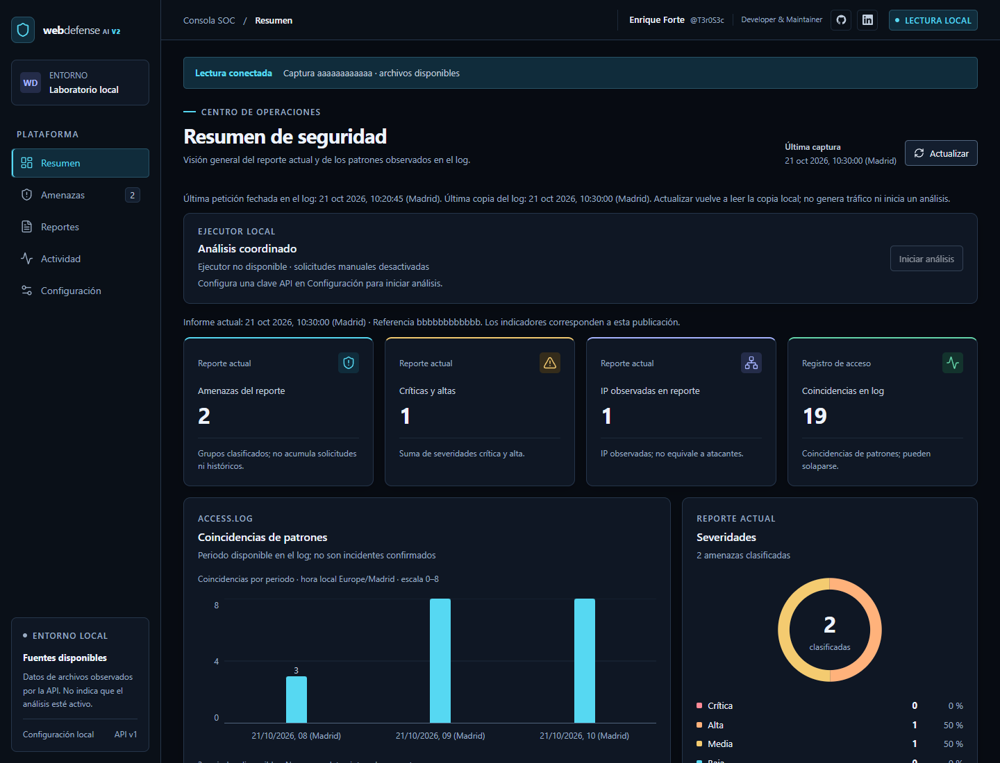
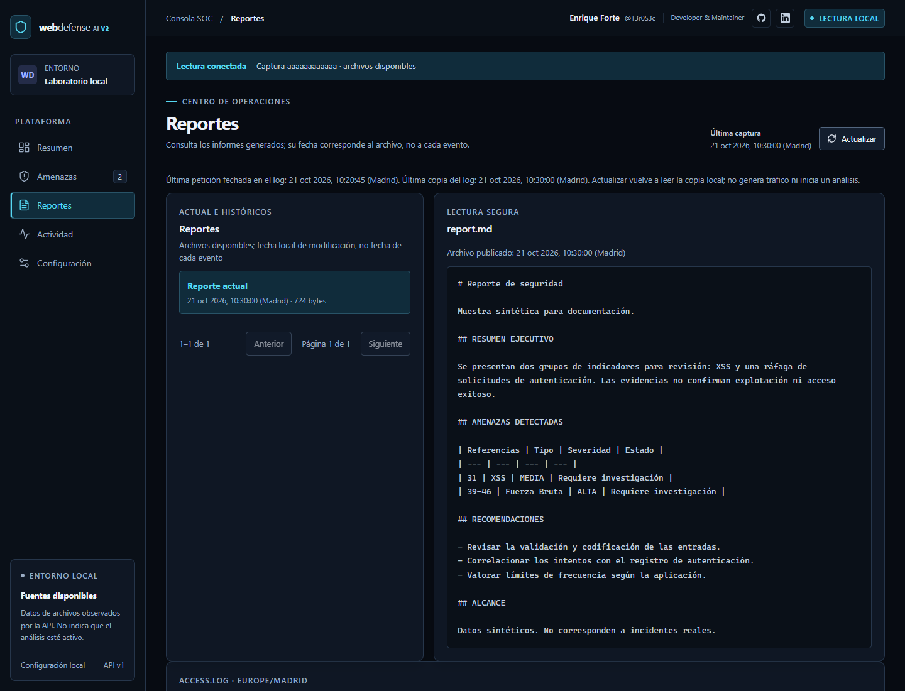

<div align="center">

# 🛡️ Web Defense AI V2

**Un laboratorio web para aprender y una consola con IA para investigar sus evidencias.**

[Instalación](#instalación) · [Arranque único](#arranque-único) · [Capturas](#capturas) · [Documentación](#documentación)

</div>

## Qué incluye el proyecto

Este repositorio reúne dos aplicaciones que trabajan juntas en tu equipo:

| Aplicación | Para qué sirve |
| --- | --- |
| **Web Defense AI V2** | Consola defensiva que analiza registros de Apache con tres agentes CrewAI y presenta hallazgos, severidades e informes con referencias a las líneas del log. |
| **Puerto Umbral** | Laboratorio web educativo con versiones vulnerable y corregida, datos ficticios y escenarios locales para observar peticiones, respuestas y cambios de estado. |

**V2** permite capturar y seguir logs, consultar auditoría de aplicación y
solicitar análisis con **Groq u OpenRouter**. Organiza el trabajo en Resumen,
Amenazas, Reportes, Actividad y Configuración.

**Puerto Umbral** incluye SQLi, XSS, traversal, inyección de comandos y fuerza
bruta, además de módulos con identidad y estado como Cargas, Preferencias y
Atraque. Incluye revisiones de artefactos ficticios sobre configuración,
criptografía, integridad y otros riesgos web.

El recorrido habitual es **explorar un escenario en Puerto Umbral → capturar sus
logs en V2 → solicitar un análisis → revisar el informe y sus evidencias**.

## Instalación

Necesitas estas herramientas instaladas:

| Herramienta | Requisito |
| --- | --- |
| Git | Para clonar el repositorio |
| Python | **3.11**, con `venv` y `ensurepip` |
| Node.js | **24 o posterior** |
| pnpm | **11.19.0**: `npm install --global pnpm@11.19.0` |
| Docker y Compose | Para Puerto Umbral; en Windows, Docker Desktop con contenedores Linux |

Clona el proyecto y entra en su carpeta:

```bash
git clone https://github.com/EnriqueForte/web-defense-ai-v2.git
cd web-defense-ai-v2
```

Instala las dependencias y compila la interfaz:

```bash
# Linux / Parrot
python3 webdefensev2.py install
```

```powershell
# Windows
py webdefensev2.py install
```

El instalador prepara `.p2`, las dependencias Python, el frontend y `.env`.
Docker se instala por separado; no necesitas activar `.p2` manualmente.

## Arranque único

Con Docker iniciado, ejecuta desde la raíz del proyecto:

```bash
# Linux / Parrot
python3 webdefensev2.py
```

```powershell
# Windows
py webdefensev2.py
```

**Un solo comando abre V2, el panel de Puerto Umbral y ambos portales, y deja
disponibles la captura, el seguimiento de logs y el análisis manual.** Cambias
de fuente y de función desde la interfaz, sin cerrar ni reiniciar la aplicación.

El primer arranque prepara las imágenes del laboratorio. Cuando aparezca
**«Consola lista»**, abre:

| Aplicación | Dirección local |
| --- | --- |
| **Web Defense AI V2** | [127.0.0.1:3000](http://127.0.0.1:3000) |
| **Panel de Puerto Umbral** | [127.0.0.1:4381](http://127.0.0.1:4381) |
| Portal vulnerable | [127.0.0.1:4380](http://127.0.0.1:4380) |
| Portal corregido | [127.0.0.1:4382](http://127.0.0.1:4382) |

Mantén la terminal abierta. **Ctrl+C detiene los servicios propios de la sesión
conservando sus datos.** Si trabajas en una VM, abre las direcciones en su navegador.

### Primer uso

1. En **Puerto Umbral**, elige módulo, modo y variante. Ejecuta desde el panel
   y consulta su respuesta y recibo de evidencia.
2. En **V2 → Actividad → Fuente de V2**, selecciona el mismo modo que has usado
   en Puerto Umbral: **Corregido** o **Vulnerable**. Después pulsa **Capturar log
   de Puerto Umbral** o **Iniciar seguimiento** para incorporar sus peticiones.
   Para los módulos avanzados, consulta también la auditoría de aplicación.
3. En **V2 → Configuración**, selecciona Groq u OpenRouter y configura tu clave
   para analizar con IA.
4. Pulsa **Iniciar análisis** y consulta **Amenazas** y **Reportes** al terminar.
   El ejecutor ya está disponible desde el arranque; si hay seguimiento activo,
   V2 lo detiene y espera a su parada antes de capturar y analizar. Al terminar,
   puedes volver a pulsar **Iniciar seguimiento** si quieres seguir recogiendo logs.

Para cambiar de fuente, detén antes el seguimiento y espera a que termine
cualquier análisis activo. Capturar o cambiar de modo actualiza la fuente;
**la clasificación de Amenazas y el informe de Reportes se actualizan al publicarse un análisis nuevo**.
Cada arranque comienza leyendo el modo corregido por defecto.

El análisis es explícito: puede enviar logs al proveedor y consumir su cuota
o saldo. La instalación comienza sin los logs ni informes privados del autor.
La auditoría de aplicación usa reglas separadas del informe de IA.

<details>
<summary>Opciones avanzadas de arranque</summary>

- `--read-only`: abre el conjunto sin ejecutor de análisis.
- `--lab-mode vulnerable`: elige la fuente inicial vulnerable; después puedes
  cambiarla desde Actividad. Los dos portales siguen disponibles.
- Para iniciar solo V2, sin Docker: `python3 webdefense.py start --mode structured`
  (Windows: `py webdefense.py start --mode structured`). Consulta cómo aportar
  tus logs en la [guía de operación](docs/INSTALACION_AUTOALOJADA.md).

El uso habitual de ambas aplicaciones no requiere estas opciones.

</details>

## Capturas

### Web Defense AI V2

| Resumen de seguridad | Consulta de informes |
| :---: | :---: |
| [](screenshots/v2-summary.png) | [](screenshots/v2-reports.png) |

*Pulsa para ampliar. Datos sintéticos de demostración.
[Procedencia de las imágenes](screenshots/README.md).*

### Puerto Umbral

| Panel de escenarios y evidencias | Portal del laboratorio |
| :---: | :---: |
| [](screenshots/PuertoUmbral%20Panel.png) | [](screenshots/PuertoUmbral%20Portal.png) |

*Capturas del laboratorio local aportadas por el autor; datos ficticios.
Pulsa para ampliar.*

## Alcance

Uso educativo local y autorizado; mantén las aplicaciones en localhost.
Un indicador requiere interpretación y no confirma por sí solo explotación.
La detección general y sus métricas no están acreditadas;
[consulta el alcance documentado](docs/CIERRE_V2_PUERTO_UMBRAL_2026_11_03.md).

## Documentación

- [Inicio rápido y ayuda de instalación](docs/INICIO_RAPIDO.md).
- [Operación de V2 y Puerto Umbral](docs/PUERTO_UMBRAL_OPERACION_LOCAL.md).
- [Configuración del proveedor LLM](docs/CONFIGURACION_PROVEEDOR_LLM.md).
- [Recorrido manual del arranque unificado observado en Parrot](docs/PUERTO_UMBRAL_RECORRIDO_MANUAL_2026_11_04.md).
- [Índice de guías, arquitectura, recuperación y actas](docs/README.md).

**Tecnologías:** Python · CrewAI · Flask · Next.js · React · TypeScript · Docker.

## Autor y licencia

**Enrique Forte · T3r0S3c** · [GitHub](https://github.com/EnriqueForte) ·
[LinkedIn](https://linkedin.com/in/enriqueforte) · [Licencia MIT](LICENSE).

V2 continúa el [proyecto original Web Defense AI](https://github.com/EnriqueForte/web-defense-ai).
