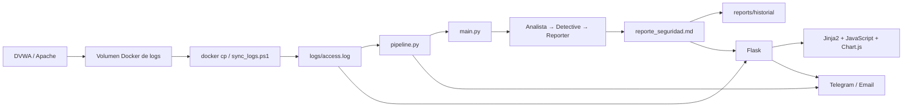
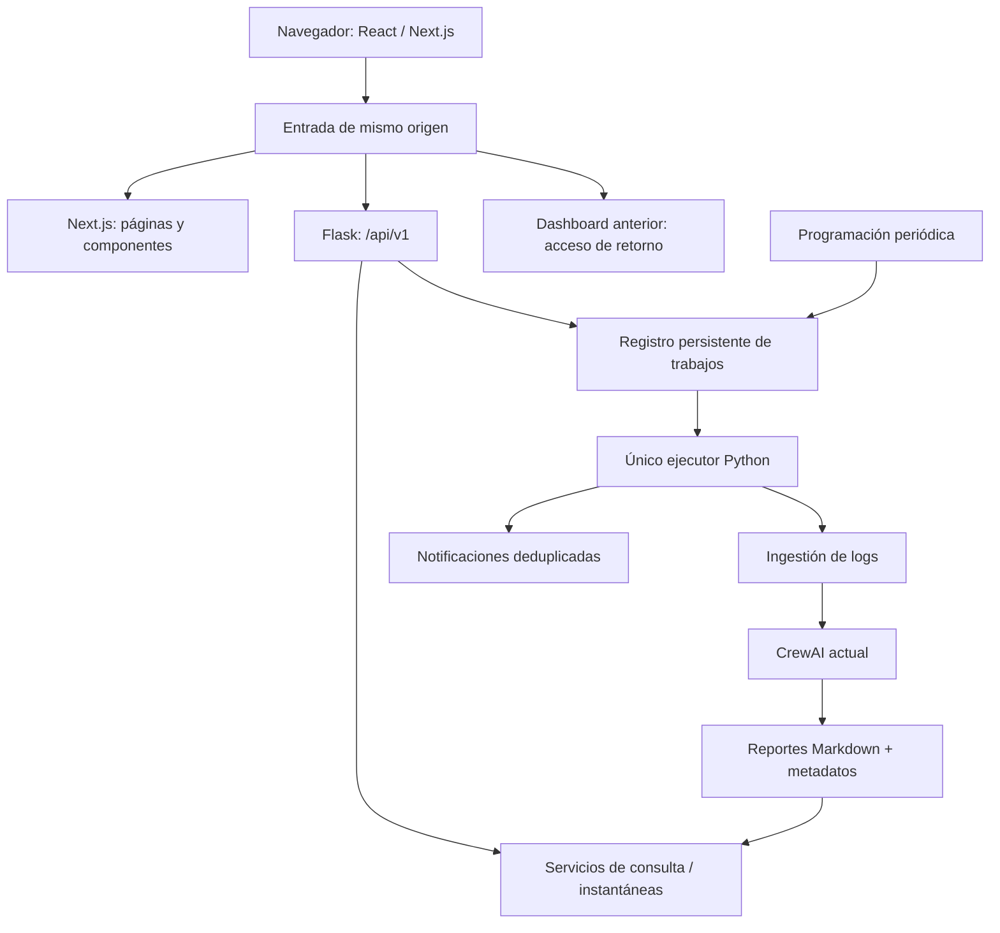

# web-defense-ai V2 — Análisis y plan de migración a React + Next.js

Línea de base histórica: 26 de septiembre de 2026, commit `f4262ef`. La denominación V2 identifica la segunda versión del proyecto. Al 28 de septiembre se completaron las fases 0–4 y se implementó la coordinación local de fase 5 con pruebas aisladas. Para fase 6, el Compose DVWA aislado y la tarea de VSCode se iniciaron y comprobaron con capturas SQLi visibles en Flask y Next.js; la integración y el piloto sostenido siguen pendientes. La fase 7 prepara el conmutador reversible de entrada, que permanece apagado mientras no se cumpla la aceptación de fase 6. Las secciones de revisión inicial conservan los hallazgos de aquella fecha y están identificadas como históricos.

El desarrollo, las pruebas y la coordinación se realizan en Codex. VSCode abre y revisa el mismo proyecto local; no es una dependencia para iniciar las fases. El [plan de agentes y tareas](PLAN_AGENTES_TAREAS.md) reúne responsabilidades y dependencias. Las mejoras del motor se evalúan por separado del cambio de interfaz.

## 1. Decisión recomendada

Estado 28/09/2026: fases 0–4 completadas; fase 5 implementada localmente sin
activar integraciones reales; el Compose aislado de fase 6 y su tarea de inicio de VSCode están comprobados. La interfaz de lectura
se implementó en Windows/Node 24. El contrato de lectura está documentado en
[FASE_2_API_LECTURA.md](FASE_2_API_LECTURA.md) y la entrega visual en
[FASE_3_BASE_VISUAL.md](FASE_3_BASE_VISUAL.md), la conexión en
[FASE_4_LECTURA_CONECTADA.md](FASE_4_LECTURA_CONECTADA.md) y la coordinación en
[FASE_5_ANALISIS_COORDINADO.md](FASE_5_ANALISIS_COORDINADO.md); resultados de fase 0 en
[FASE_0_LINEA_BASE.md](FASE_0_LINEA_BASE.md). Se incorporaron tests aislados,
instalación limpia y restauración verificada.
Los resultados de pruebas fallidas de la sección 12 describen la revisión inicial del día 26, no el comportamiento actual.

Fase 1: H01–H09 implementados y validados. La suite aislada ampliada
valida la ruta vacía, sincronización honesta, consulta sin Docker, parser, severidades,
IP y cronología. La vista de reportes filtra elementos y atributos no permitidos; las
comprobaciones usan un DOM sintético y no sustituyen revisión en un navegador real.
La migración progresiva utiliza **Next.js con React y TypeScript**, conserva **Flask como API y Python/CrewAI como motor de análisis**. Ambos dashboards conviven durante la transición; las plantillas se retirarán únicamente después de demostrar equivalencia funcional y ensayar la reversión.

El proyecto separa el motor y la interfaz. Las fases 1 y 2 desacoplaron las lecturas de la sincronización de Docker y las notificaciones. La fase 5 incorporó coordinación local de análisis; los reportes Markdown variables y el piloto real siguen condicionando el despliegue.

Secuencia: **pruebas, correcciones, API, base visual y lectura conectada completadas → coordinación local de fase 5 implementada → validar el laboratorio y las integraciones en piloto → cambiar la entrada principal**.

Ninguna migración puede garantizar ausencia absoluta de fallos. Este plan reduce el riesgo mediante cambios pequeños, contratos verificables, una única ejecución del motor y reversión sin transformar los datos históricos.

## 2. Alcance y evidencia de la revisión inicial (26/09/2026)

Se revisaron los 12 archivos Python entonces versionados, ambas plantillas, estilos, configuración de ejemplo, dependencias, Docker Compose, sincronización de logs, documentación y estructura de pruebas. También se inspeccionó una captura del dashboard. En aquella fecha aún no existía `frontend/`.

Se ejecutaron comprobaciones de sintaxis y pruebas exploratorias con datos sintéticos, directorios temporales y llamadas a Docker simuladas. Se comprobó la vinculación de las funciones JavaScript con Node. No se ejecutaron agentes de IA, contenedores, correos ni mensajes de Telegram; tampoco se modificaron logs o reportes operativos ni se leyó el archivo de secretos `.env` para el análisis.

Entorno observado: Python 3.11.9 y Node 24.19.0. El entorno virtual permite importar Flask, Jinja2, dotenv y CrewAI; no se encontró pytest instalado. Esto no demuestra que una instalación limpia sea reproducible.

Límites: no se verificó el comportamiento completo en un navegador conectado al laboratorio, la disponibilidad del proveedor de IA, la entrega de notificaciones ni la instalación desde cero. Tampoco es una auditoría exhaustiva de vulnerabilidades de todas las dependencias. Las incidencias indicadas como inspección requieren su prueba de regresión al corregirse.

## 3. Arquitectura observada inicialmente y contrato legado conservado

El diagrama y la tabla siguientes describen la revisión inicial. Desde entonces se añadieron la API `/api/v1`, la captura de lectura y `frontend/`. Las consultas de estado ya no ejecutan Docker; la nueva UI consume Flask en modo lectura desde la fase 4.

| Área | Situación el 26/09/2026 | Tratamiento recomendado entonces |
|---|---|---|
| Análisis | Tres agentes secuenciales, proveedor Groq, filtrado previo de Apache | Conservar Python, prompts y secuencia en la primera entrega |
| Automatización | Bucle en `pipeline.py`, sincroniza y lanza `main.py` como subproceso | Conservar inicialmente; unificar coordinación antes del análisis manual nuevo |
| Backend | Flask combina rutas HTML, JSON, lectura de archivos, parsers y efectos externos | Extraer servicios gradualmente y añadir API versionada |
| Interfaz | Jinja2, estilos propios y JavaScript incrustado | Sustituir por componentes React, manteniendo la identidad de web-defense-ai V2 y la firma T3r0S3c |
| Persistencia | Reporte actual e históricos Markdown; no hay base de incidentes | Mantener archivos; añadir metadatos compatibles, sin conversión destructiva |
| Gráficos | Chart.js 4.4.1 desde CDN | Conservar inicialmente el tipo de gráfico, empaquetar y actualizar sus datos |
| Integraciones | Docker CLI, Telegram HTTP y SMTP | Mantenerlas exclusivamente en Python |
| Despliegue | Compose declara DVWA, MySQL y un contenedor Python inactivo | Documentar despliegue real; añadir servicios de aplicación en una fase propia |
| Pruebas | En la revisión inicial, `tests/` solo contenía `__init__.py` | Crear pruebas de comportamiento antes de refactorizar |

La base MySQL pertenece a DVWA, no al sistema de incidentes. El servicio `ai-engine` ejecuta `tail -f /dev/null`: Compose no pone automáticamente en marcha el pipeline ni Flask.

### Contrato legado conservado tras las fases 1 y 2

| Ruta | Función real | Compatibilidad que debe preservarse |
|---|---|---|
| `GET /` | Renderiza métricas, amenazas, timeline, cinco históricos y ocho líneas de log | Debe seguir disponible como retorno durante la transición |
| `GET /api/estado` | Lee archivos locales y devuelve `stats`, `amenazas`, `historial`, `log`, `ips_log`, `timeline`, `timestamp` | Consulta sin proceso Docker; se conservan los campos anteriores |
| `POST /api/sincronizar` | Copia el log de Docker al archivo local | Informa que no ejecuta IA; no archiva reportes anteriores ni dispara avisos |
| `GET /report/<nombre>` | Muestra Markdown histórico o actual, con validación del nombre | Mantener enlaces existentes y respuestas de archivo inexistente |

El refresco consulta el estado local cada 15 segundos con una llamada; actualiza terminal y series del timeline. Métricas, tabla e historial siguen representando el reporte disponible al cargar la página. El botón sincroniza el log y deja explícito que no ejecuta un análisis nuevo.

## 4. Hallazgos de la revisión inicial y riesgos pendientes

Esta tabla registra los hallazgos tal como se observaron el 26/09/2026; sus rutas y números de línea son referencias históricas. H01–H09 se corrigieron en la fase 1. La fase 2 añadió lecturas acotadas y publicación atómica para los caminos existentes, lo que atiende parte de H10–H11, y la fase 0 corrigió la declaración de dependencias de H15. La coordinación de ejecuciones, alertas y acceso compartido sigue pendiente. Consultar las entregas de cada fase para el alcance validado.

**Prioridad A:** bloquea una transición fiable o afecta a la seguridad del panel. **Prioridad B:** afecta a integridad, operación o crecimiento. **Prioridad C:** experiencia y mantenimiento.

| ID | Prioridad | Hallazgo y evidencia | Consecuencia y actuación |
|---|---|---|---|
| H01 | A | [Botón y endpoint](<F:/Proyectos ChatGpt/web-defense-ai V2/dashboard/app.py:337>): sincronizar no ejecuta el análisis | Puede anunciar éxito y notificar sobre información antigua. Separar sincronizar de analizar; crear trabajo asíncrono real antes de habilitar el nuevo botón |
| H02 | A | [Rama sin amenazas](<F:/Proyectos ChatGpt/web-defense-ai V2/dashboard/templates/index.html:119>): usa `a.timestamp` fuera del bucle | Reproducido: `UndefinedError: 'a' is undefined` sin reporte. Corregir y cubrir estados iniciales |
| H03 | A | [Actualización del timeline](<F:/Proyectos ChatGpt/web-defense-ai V2/dashboard/templates/index.html:476>): una segunda declaración captura su propia función | Comprobado en Node: `originalActualizarLog === actualizarLog`. La llamada produce recursión; eliminar esta sustitución y usar una única fuente de datos |
| H04 | A | [Logs](<F:/Proyectos ChatGpt/web-defense-ai V2/dashboard/templates/index.html:236>) se interpolan en `innerHTML`; [reportes](<F:/Proyectos ChatGpt/web-defense-ai V2/dashboard/templates/report.html:246>) usan HTML de Marked sin sanitización | Hay una vía de XSS al visualizar entradas controladas por un atacante o contenido del modelo. Renderizar logs como texto y Markdown con una política restrictiva. Detectado por inspección; no se ejecutaron payloads |
| H05 | A | [Estado](<F:/Proyectos ChatGpt/web-defense-ai V2/dashboard/app.py:304>) ejecuta `docker cp` sin timeout ni comprobar su resultado | Reproducido: responde 200 con fallo de copia simulado; propaga excepción si Docker no existe. Las visitas generan trabajo externo. Convertir lecturas en operaciones sin efectos y exponer el estado real de ingestión |
| H06 | B | [Estadísticas](<F:/Proyectos ChatGpt/web-defense-ai V2/dashboard/app.py:206>) calculan medias por diferencia | Reproducido: una amenaza BAJA se cuenta como MEDIA. Añadir categorías explícitas y separar desconocidas |
| H07 | B | [Parser](<F:/Proyectos ChatGpt/web-defense-ai V2/dashboard/app.py:34>) depende del texto de cabeceras y elimina celdas vacías | Puede desplazar columnas o perder amenazas. Preservar columnas vacías, normalizar valores y validar formatos con fixtures |
| H08 | B | [IP y timestamp](<F:/Proyectos ChatGpt/web-defense-ai V2/dashboard/app.py:83>): sustituye IP desconocida por la más frecuente; usa fecha del reporte actual | Reproducida la sustitución de IP sin evidencia. Puede atribuir ataques al origen incorrecto; no existe fecha individual fiable del evento. Mantener `null`/desconocido y distinguir procedencias |
| H09 | B | [Timeline](<F:/Proyectos ChatGpt/web-defense-ai V2/dashboard/app.py:141>) ordena texto y aplica reglas independientes | Reproducido: 01/May aparece antes de 30/Apr. Una línea puede contar en varias categorías; no equivale a amenazas del último reporte. Usar fechas reales y explicar el alcance |
| H10 | B | [Lecturas](<F:/Proyectos ChatGpt/web-defense-ai V2/dashboard/app.py:127>) recorren el log entero repetidamente, incluso al parsear históricos | El coste crece con archivo y usuarios. Leer una instantánea por consulta, limitar el terminal y después introducir procesamiento incremental si las mediciones lo justifican |
| H11 | B | [Guardado del motor](<F:/Proyectos ChatGpt/web-defense-ai V2/main.py:201>) y [salida de tarea](<F:/Proyectos ChatGpt/web-defense-ai V2/agents/report_generator.py:61>) escriben el reporte; no hay exclusión global | Lecturas parciales, carreras y reutilización de reportes antiguos. Un responsable de publicación, escritura temporal y sustitución atómica; coordinar ejecuciones |
| H12 | B | [Alertas](<F:/Proyectos ChatGpt/web-defense-ai V2/config/notifications.py:55>) y [pipeline](<F:/Proyectos ChatGpt/web-defense-ai V2/pipeline.py:101>) tratan CRITICA/CRÍTICA de forma distinta; el endpoint incluye MEDIA | Conteos inconsistentes y posibles avisos repetidos. Normalizar severidad, definir una política compartida y deduplicar por análisis y destino |
| H13 | B | [Retención](<F:/Proyectos ChatGpt/web-defense-ai V2/dashboard/app.py:253>) se ejecuta desde el endpoint con límite 50; el pipeline no la aplica | Dos caminos con comportamiento distinto y posible eliminación al probar acciones. Respaldar y centralizar retención, fuera de las lecturas |
| H14 | A al exponer en red | [Arranque Flask](<F:/Proyectos ChatGpt/web-defense-ai V2/dashboard/app.py:404>): debug activo en todas las interfaces; no hay autenticación en las rutas revisadas | Antes de acceso compartido: servidor adecuado, debug desactivado y protección de lecturas y acciones. El proxy por sí solo no autentica |
| H15 | B | [Dependencias](<F:/Proyectos ChatGpt/web-defense-ai V2/requirements.txt>) no declaran Flask; incluyen pywin32 sin condición. [Pipeline](<F:/Proyectos ChatGpt/web-defense-ai V2/pipeline.py:78>) fija el ejecutable de Windows | La instalación limpia y el contenedor Linux requieren corrección. No asumir que el entorno virtual actual es reproducible |
| H16 | B | [Configuración](<F:/Proyectos ChatGpt/web-defense-ai V2/config/settings.py:17>) no se aplica uniformemente: modelo y límites se fijan de nuevo en otros módulos | Variables de entorno pueden no controlar lo esperado. Consolidar valores efectivos y documentar cambios sin retocar simultáneamente la detección |
| H17 | C | [Plantilla](<F:/Proyectos ChatGpt/web-defense-ai V2/dashboard/templates/index.html:20>) presenta sistema/pipeline activos de forma fija; [CSS](<F:/Proyectos ChatGpt/web-defense-ai V2/dashboard/static/style.css>) usa textos de 9–11 px y rejillas sin breakpoints | Confunde conexión con salud real y dificulta lectura móvil. Estados verificables, tipografía legible, teclado y distribución adaptable |

En la revisión inicial, el parser aceptaba direcciones IPv4 inválidas y omitía IPv6; la fase 1 corrigió ambos casos y dejó de atribuir una IP desconocida al origen más frecuente. Una IP observada tampoco demuestra quién es el atacante.

Otros límites del motor que deben documentarse: procesa una selección de las últimas 100 líneas, aplica patrones diferentes a los del timeline y trabaja con inferencias del modelo. La respuesta HTTP o visitar una ruta vulnerable no prueba por sí solo que un ataque haya tenido éxito. Mejorar estas reglas constituye un trabajo posterior de detección; la interfaz debe presentar evidencia disponible y evitar afirmar confirmación sin ella.

El fallback de modelos de `main.py` captura errores al construir el objeto LLM. No demuestra recuperación ante un fallo posterior durante `crew.kickoff()`. También puede finalizar sin un reporte nuevo cuando no hay datos, por lo que un código de salida correcto no basta para declarar un análisis completado.

## 5. Arquitectura objetivo

La entrada distribuye páginas a Next.js y `/api/*` a Flask. En desarrollo se puede configurar un rewrite de Next.js hacia Flask; en el despliegue compartido, usar un proxy inverso. No duplicar reglas de detección en Route Handlers ni ejecutar CrewAI dentro del proceso de Next.js. Si se añade una capa intermedia, limitarla a sesión, encaminamiento y adaptación.

Durante el desarrollo, mantener Flask en el puerto actual y Next.js en otro. La reversión final debe poder cambiar la entrada principal a Flask sin depender de que Next.js esté disponible. Evitar asumir que basta con publicar Flask bajo `/legacy`: sus rutas de recursos y enlaces son absolutas. Usar una dirección interna de retorno independiente o adaptar explícitamente esas rutas y probarlas.

### Selección tecnológica

| Pieza | Propuesta | Justificación y límite |
|---|---|---|
| Interfaz | Next.js, React, TypeScript, App Router | Componentes, rutas y layouts coherentes. Componentes de cliente para filtros, tabla, terminal y gráficos |
| Estilos | Tokens CSS existentes + Tailwind; primitivas accesibles cuando hagan falta | Conservar paleta e identidad; elegir un conjunto pequeño de componentes, sin rehacer el diseño en cada página |
| Datos del cliente | TanStack Query | Centralizar carga, caché en memoria, error y actualización; configurar explícitamente intervalos y reintentos |
| Visualización | Chart.js empaquetado, encapsulado en un componente React | Reduce el cambio inicial y permite mantener las cinco series. Cambiar de biblioteca solo por una necesidad demostrada |
| Markdown | react-markdown y soporte de tablas GFM; HTML crudo deshabilitado | Mostrar los reportes históricos sin inyectar HTML libre ni permitir protocolos de enlace peligrosos |
| Backend | Flask y servicios Python extraídos por responsabilidad | Mantener compatibilidad con motor e integraciones |
| Contratos | OpenAPI + modelos de validación Python; cliente TypeScript generado o verificado | Evitar discrepancias entre tipos declarados y JSON recibido |
| Pruebas | pytest, pruebas de componentes y Playwright | Cubrir comportamiento, contratos y recorridos completos |
| Trabajos | Registro SQLite local y un ejecutor Python como primera opción | Persistir estado y exclusión en una sola máquina. Cola externa solo si posteriormente hacen falta varios nodos |

Next.js no es necesario para ejecutar los agentes ni hace más precisa la detección. Su valor aquí es organizar una interfaz con varias vistas y estados. Una aplicación React con Vite sería más simple de alojar si el único objetivo fuese un panel estático; Next.js encaja con la evolución hacia informes, detalle y administración, a cambio de mantener también un runtime Node.

La fase 3 instaló y verificó Next.js 16.3.6, React 19.2.8 y Node 24.19.0 con `pnpm-lock.yaml`. Revisar los parches antes de publicar la consola fuera del entorno local; el detalle de versiones y límites está en [FASE_3_BASE_VISUAL.md](FASE_3_BASE_VISUAL.md).

Los layouts pueden permanecer en servidor y las partes interactivas marcarse como componentes de cliente. Mantener secretos en Python; los valores `NEXT_PUBLIC_*` se incorporan al cliente y nunca deben contener credenciales. [Componentes de servidor y cliente](https://nextjs.org/docs/app/getting-started/server-and-client-components).

Configurar expresamente el refresco y los reintentos: TanStack Query puede volver a consultar al recuperar foco o conexión. Para este proyecto se propone una consulta compartida cada 15 segundos por pestaña visible, sin otra consulta simultánea al mismo estado, y retroceso progresivo ante fallos. [Valores predeterminados de TanStack Query](https://tanstack.com/query/latest/docs/framework/react/guides/important-defaults).

### API versionada existente y acciones propuestas

Los cinco endpoints GET de lectura de la tabla existen desde la fase 2; la especificación exacta está en [FASE_2_API_LECTURA.md](FASE_2_API_LECTURA.md). La fase 5 añadió rutas de análisis, estado persistente y señal local del ejecutor en `salud`; la activación real está pendiente del piloto.

| Endpoint nuevo | Datos / resultado | Regla |
|---|---|---|
| `GET /api/v1/estado` | Instantánea con métricas, amenazas resumidas, log reciente, timeline, salud y versión | Solo lectura; no ejecuta Docker, análisis ni notificaciones |
| `GET /api/v1/amenazas` | Filtros por tipo/severidad/IP, paginación y alcance del reporte actual | Existe desde fase 2; no simula una base histórica de incidentes |
| `GET /api/v1/reportes` | Históricos paginados, fecha de archivo y metadatos disponibles | No limita todo el acceso a los cinco elementos del dashboard |
| `GET /api/v1/reportes/{id}` | Markdown y metadatos del reporte | Identificador resuelto en servidor, sin aceptar rutas arbitrarias |
| `POST /api/v1/analisis` | `202` con identificador del trabajo | Localhost, conmutador desactivado por defecto, clave de idempotencia y exclusión compartida; autenticación central pendiente de fase 6 |
| `GET /api/v1/analisis/{id}` | Estado, fase real, tiempos, resultado y error resumido | Sobrevive a reinicios; no inventa porcentaje de progreso |
| `GET /api/v1/salud` | Metadatos ligeros de fuentes locales y señal local del ejecutor | No hace llamadas pagadas ni envía mensajes para comprobar disponibilidad |

Estados de trabajo: `queued`, `running`, `succeeded`, `failed`, `interrupted`; representar también resultado sin datos nuevos. Un POST duplicado con la misma clave devuelve el mismo trabajo. Una nueva solicitud incompatible con un trabajo activo devuelve un conflicto definido, sin crear una segunda ejecución. No reintentar automáticamente mutaciones por un error de conexión: consultar primero el identificador/idempotencia.

Separar `requested_at`, `started_at`, `finished_at`, `last_ingested_at`, `last_analyzed_at` y `fetched_at`. Utilizar ISO 8601 con zona horaria y representar fechas de eventos solo cuando existan en la evidencia. La UI puede mostrar Europe/Madrid y debe identificar la zona. Un cambio en el refresco no cambia la fecha del último análisis.

Cada amenaza necesita identificador estable dentro del reporte, severidad normalizada, tipo, estado, IP opcional, procedencia y enlace al reporte. Si no se puede correlacionar una línea original, mostrar que la evidencia no está disponible. No usar el número de fila como identidad global de un incidente.

Métricas y tabla deben compartir `snapshot_id`/`report_id`; las estadísticas globales corresponden al conjunto completo del alcance, no a la página visible. El timeline incluirá origen y periodo y se etiquetará como coincidencias de patrones, salvo que una fase posterior lo derive de los mismos eventos normalizados. Mantener categorías BAJA y DESCONOCIDA explícitas.

Errores uniformes con código, mensaje seguro y `request_id`, sin trazas o secretos al cliente. Distinguir ausencia de datos, datos anteriores disponibles, lectura fallida e indisponibilidad. Responder con códigos HTTP adecuados y conservar la última instantánea válida con aviso de antigüedad cuando proceda. Estado, reportes y logs sensibles llevarán política explícita de no almacenamiento en cachés compartidas; tampoco deben quedar como datos estáticos de compilación de Next.js.

Las rutas anteriores y la forma JSON de `/api/estado` se conservaron. La corrección de BAJA frente a MEDIA tiene casos de regresión. Las consultas de estado ya no sincronizan Docker; la sincronización se solicita por separado y su resultado no implica un análisis nuevo.

## 6. Diseño propuesto: consola de ciberseguridad operativa

La fase 3 implementó la composición visual con datos sintéticos. La fase 4 conectó resumen, amenazas, actividad y reportes a Flask; la fase 5 añadió la acción manual controlada y el estado del ejecutor. El piloto real sigue pendiente.

Usar el nombre web-defense-ai V2 y conservar T3r0S3c como firma del autor, fondo azul oscuro, acentos cian/verde y terminal monoespaciado. Reservar rojo y ámbar para severidad; aumentar el contraste del texto secundario y reducir el ruido decorativo. El aspecto debe ayudar a investigar, con información legible y estado fiable.

| Vista | Experiencia propuesta | Datos necesarios |
|---|---|---|
| Resumen | Métricas seleccionables, actividad temporal, último análisis y salud del sistema | Instantánea común y fechas diferenciadas |
| Amenazas | Búsqueda, filtros combinables, ordenación y panel lateral con evidencia | Campos normalizados y vínculo a reporte; indicar datos desconocidos |
| Reportes | Lista navegable, búsqueda por fecha, lectura segura y descarga del original | Históricos completos y paginación |
| Actividad | Terminal con pausa del autodesplazamiento, búsqueda y aviso de conexión | Ventana de log limitada; retención y cursor si se amplía |
| Sistema | Último ciclo, origen del log y estado verificable de integraciones | Heartbeat y resultados observados; no inferir salud de que exista una clave |

La primera entrega conectada de la fase 4 incluye resumen, listas de amenazas y reportes, y actividad reciente. Vistas adicionales se habilitarán después de la equivalencia básica. No incluir botones de bloquear IP o remediar si no existe una función real que los respalde.

Los filtros se conservan en la URL y no desaparecen al refrescar. Las métricas, tabla y gráfico cambian sin recargar la página. Mostrar estados de carga, vacío, datos antiguos, error parcial y reconexión. Una acción puede estar «en cola» o «analizando», pero nunca «completada» por haber enviado una petición.

Usar controles de teclado, foco visible, etiquetas y descripciones del gráfico; proporcionar alternativa tabular para los datos. Adaptar a móvil, tableta y escritorio. Respetar la preferencia de movimiento reducido. Los contrastes se medirán durante la implementación: la captura revisada sugiere problemas de legibilidad, pero no se ha efectuado una medición formal de accesibilidad.

## 7. Plan por fases y condiciones de avance

Estimación orientativa formulada antes de iniciar la migración, para una persona con dedicación completa, acceso al laboratorio y sin cambios grandes de alcance. Incluye implementación y validación, no contratación, esperas externas ni operación 24/7. Reestimar el trabajo restante de fases 4–7 cuando se concrete su alcance.

| Fase | Trabajo | Entregable y criterio para avanzar | Reversión | Esfuerzo |
|---|---|---|---|---|
| 0. Línea base | Inventariar flujos, dependencias y variables efectivas; respaldar reportes/logs; preparar fixtures anonimizados; registrar versiones y tiempos | Entorno reproducible, catálogo de comportamiento y lista de fallos previos; copia restaurada en directorio separado | Ningún cambio operativo; conservar el punto de partida identificado | 2–3 días |
| 1. Estabilización | Corregir pantalla vacía, recursión, renderizado inseguro, errores de sincronización y métricas. Normalizar fechas/IP sin fabricar evidencia. Renombrar la acción antigua según lo que realmente hace | Pruebas de regresión de H01–H09; interfaz anterior usable como retorno; no se afirma un análisis nuevo al sincronizar | Cambios pequeños y reversibles; no restaurar una versión insegura como retorno público | 3–5 días |
| 2. API y lectura | Extraer servicios, añadir `/api/v1`, contratos y metadatos; desacoplar ingestión de consultas; asegurar publicación atómica en todos los caminos de escritura | GET sin efectos externos; fixtures producen respuestas esperadas; cliente anterior conserva su contrato; instantáneas consistentes | Deshabilitar endpoints nuevos; conservar formato Markdown y rutas anteriores | 4–6 días |
| 3. Base visual | Crear `frontend/`, Next.js/React/TypeScript, tokens, layout, navegación, estados y componentes con datos simulados | Compilación y verificaciones correctas; vistas clave legibles a varios tamaños; ninguna dependencia del motor para construir la UI | Detener la aplicación nueva; Flask continúa disponible | 3–4 días |
| 4. Lectura conectada | Integrar métricas, amenazas, timeline, terminal y reportes; polling compartido; filtros persistentes y manejo de errores | Equivalencia con fixtures y capturas del mismo `snapshot_id`; reportes antiguos accesibles; no se duplican consultas por componente | Desactivar módulos nuevos o retornar a Flask | 4–6 días |
| 5. Análisis e integraciones | Registro persistente de trabajos, un ejecutor, coordinación de ciclos/manual, idempotencia y notificaciones deduplicadas; conectar botón real | Doble clic o reintento no duplica trabajo; reinicio no muestra éxito falso; reporte nuevo publicado y notificaciones verificadas en entorno de prueba | Desactivar admisión manual; terminar/reconciliar trabajos activos; mantener un único programador | 4–6 días |
| 6. Validación y despliegue piloto | Pruebas completas, carga representativa, autenticación si hay acceso compartido, empaquetado, observabilidad y ensayo de retorno | Sin fallos bloqueantes; restauración ensayada; estabilidad durante al menos 24–48 horas y diez ciclos completados, lo que tarde más | Cambiar entrada a Flask validado; conservar motor y datos | 3–5 días |
| 7. Cambio principal y cierre | Preparar conmutador reversible; tras aceptar fase 6, Next.js pasa a ser la entrada habitual; actualizar operación, registrar métricas y mantener retorno temporal | Recorridos aceptados; periodo sugerido de siete días de uso sin incidencias bloqueantes; decisión documentada de retirada | Desactivar `NEXT_PRIMARY_ENABLED` y volver a Flask | 1–2 días de trabajo + observación |

**Total orientativo inicial: 24–37 jornadas de trabajo**, aproximadamente 5–8 semanas laborables, más las ventanas de observación que no puedan solaparse. No es una fecha comprometida. La entrega de lectura está disponible desde la fase 4; la acción manual está implementada pero desactivada hasta el piloto, y la sustitución principal requiere las fases siguientes.

### Orden de cambios revisables

1. Documentación de línea base y fixtures, instalación reproducible.
2. Correcciones de estabilidad y representación segura del dashboard anterior.
3. Servicios de consulta, API versionada y compatibilidad.
4. Estructura Next.js y componentes con datos de prueba.
5. Dashboard y reportes conectados en modo lectura.
6. Coordinación persistente de análisis e integraciones.
7. Configuración de ejecución, pruebas completas y procedimiento de cambio.

Cada cambio debe incluir propósito, pruebas, compatibilidad y forma de desactivarlo. Evitar una entrega única que cambie prompts, persistencia, contenedores e interfaz al mismo tiempo.

## 8. Protección del motor y de los datos

Durante las fases de lectura no deben existir dos pipelines trabajando sobre el mismo directorio. Ambas interfaces consumen el mismo backend y las mismas instantáneas. Las comparaciones en paralelo no ejecutan análisis ni duplican notificaciones.

Antes de la fase 5, definir el cambio de autoridad: detener la admisión de ciclos del programador antiguo, esperar a su ejecución activa, registrar el último resultado, iniciar el coordinador nuevo y comprobar que solo este puede adquirir el bloqueo. El análisis manual y el periódico pasan por el mismo mecanismo. La reversión debe realizar la secuencia inversa, nunca arrancar ambos a la vez.

SQLite serviría inicialmente para trabajos, bloqueo duradero y registro de entregas, no para sustituir los reportes. Usar almacenamiento local persistente y transacciones; no un archivo compartido entre varios nodos. Recuperar trabajos que estaban `running` como interrumpidos o reconciliarlos con su resultado al reiniciar. La entrega exactamente una vez a servicios externos no se puede garantizar sin soporte del receptor: registrar estados ambiguos y evitar reenvíos ciegos tras un timeout.

Desde la fase 2, `main.py` es el único responsable de publicar el reporte actual mediante sustitución atómica; `agents/report_generator.py` ya no escribe el destino final. La fase 5 coordina trabajos manuales y periódicos con bloqueo local para que no publiquen simultáneamente y conserva el reporte anterior si falla el motor antes de publicar.

La sincronización del log necesita la misma precaución: copiar a un archivo temporal y publicar al completarse, para que una consulta no observe una copia incompleta. Si más adelante API y ejecutor se alojan junto a DVWA, evaluar montar el volumen de logs en modo lectura en vez de depender de `docker cp`. Next.js no necesita acceso al socket Docker, a `.env` ni a los archivos brutos.

Preservar nombres, Markdown y enlaces históricos. Los metadatos o JSON son aditivos y versionados. Para reportes antiguos, distinguir fecha derivada del nombre, fecha de archivo y fecha desconocida; no reconstruir tiempos de evento que no se conservaron. No ejecutar la limpieza de históricos como parte de la migración.

Si el panel se comparte, proteger también logs y reportes, no solo el botón. Aplicar autenticación central coherente para Next.js, Flask y retorno; autorización para acciones, protección CSRF cuando se usen cookies, límites de peticiones y HTTPS en el punto de entrada. CORS no sustituye estos controles. Mantener DVWA aislada del punto de publicación de la consola.

## 9. Matriz de validación y aceptación

| Área | Escenarios obligatorios | Resultado esperado |
|---|---|---|
| Inicio | Sin logs, sin reporte, reporte vacío | La página carga y explica qué falta; no inventa cero amenazas confirmadas ante un error |
| Parser | Cabeceras variables, celdas vacías, acentos, tabla incompleta, severidad desconocida | No desplazar campos; conservar desconocidos y reportar degradación |
| Métricas | CRÍTICA/CRITICA, ALTA, MEDIA, BAJA y desconocidas | Conteos exactos según fixtures; mismas reglas entre API, tabla y avisos |
| Fechas | Cambio de día/mes/año, offsets y horario de verano | Orden temporal correcto y zona explícita; análisis y refresco diferenciados |
| Identidad | IP faltante, inválida, IPv6, tráfico de pasarela | Nunca asignar por frecuencia una IP como evidencia de ataque |
| API | Docker ausente, timeout, resultado fallido, archivo ilegible y escritura concurrente | Respuesta controlada, última instantánea válida cuando exista y aviso de estado |
| Interfaz | Filtros y navegación durante refresco; error de un panel; varios tamaños | Estado del usuario conservado y errores visibles sin bloquear toda la consola |
| Seguridad de contenido | HTML en log/Markdown, enlaces con protocolos peligrosos y archivos no permitidos | Se muestran como datos o se rechazan; no se ejecuta contenido ni se accede fuera del directorio |
| Concurrencia | Doble clic, dos pestañas, análisis manual durante ciclo, reintento de POST | Un único trabajo aplicable, respuesta determinista y ausencia de carreras |
| Fallos del motor | Límite del proveedor, excepción, timeout, salida sin reporte nuevo | Trabajo fallido/sin datos; reporte anterior conservado y sin notificar como análisis nuevo |
| Integraciones | Transporte simulado, timeout y entrega ambigua | Conteos normalizados, registro de envío y política explícita de reintento |
| Históricos | Ambos formatos de nombre existentes, paginación, enlaces antiguos y descarga | Mismo contenido, sin pérdida ni eliminación al consultar |
| Regresión | Recorridos en interfaz anterior y nueva contra la misma instantánea | Equivalencia salvo correcciones aprobadas y documentadas |
| Despliegue | Instalación limpia, arranque, reinicio y retorno | No depende de la máquina del desarrollador; procesos y datos recuperables |

Pruebas rápidas sin red ni LLM en cada cambio: sintaxis, contratos y lógica pura. Componentes con respuestas simuladas y pruebas de navegador para recorridos críticos. Reservar la integración real con Docker/LLM/Telegram/SMTP para el laboratorio previsto, con destinos de prueba y presupuesto acotado.

Objetivos iniciales de rendimiento, pendientes de medir con carga representativa: consulta de estado p95 inferior a 500 ms en hardware documentado, filtros por debajo de 200 ms con una página representativa y visibilidad de una nueva instantánea en el siguiente intervalo de 15 segundos más latencia. Medir por separado ingestión, análisis IA y visualización; el polling no hace que un análisis periódico sea instantáneo.

Ensayar al menos 1, 5 y 10 clientes simultáneos y archivos de tamaño actual y ampliado. Cada cliente adicional no debe generar más sincronizaciones Docker o ejecuciones IA. No establecer un porcentaje de cobertura como sustituto de comprobar estos comportamientos.

Condiciones para cambiar la entrada principal: todas las funciones existentes representadas, diferencias de datos explicadas, pruebas críticas aprobadas, cero pérdida de reportes, cero ejecuciones duplicadas en los escenarios ensayados, observación satisfactoria y reversión completada en un ensayo.

## 10. Reversión y operación

1. Antes del piloto, conservar una versión ejecutable del Flask corregido, configuración de entrada anterior, dependencias fijadas y copia de datos con comprobación de integridad. Los secretos se respaldan por separado y nunca se versionan.
2. Disponer de conmutadores de activación para interfaz nueva y admisión de análisis manual. `ANALYSIS_MANUAL_ENABLED` controla ya la admisión; el conmutador para la entrada principal sigue pendiente.
3. Revertir ante pantalla inutilizable, errores reiterados, discrepancias inexplicadas, trabajo duplicado, pérdida de datos o ejecución de contenido no confiable. Como umbral inicial de operación: tres fallos consecutivos de estado o más de 1 % de respuestas 5xx durante cinco minutos con tráfico suficiente; ajustar durante el piloto de fase 6.
4. Si falla la interfaz, dirigir la entrada al Flask validado, manteniendo el backend compatible y el ejecutor. Objetivo inicial: retorno en menos de diez minutos, medido en el ensayo de la fase 6.
5. Si falla la API nueva, desactivarla o volver a la versión compatible identificada. Verificar lecturas y salud; un cambio de interfaz no resuelve por sí solo una incidencia de backend.
6. Si falla la coordinación de trabajos, cerrar admisión, esperar o marcar el trabajo activo según su estado, reconciliar resultados y notificaciones y solo después restaurar la programación anterior.
7. Verificar reporte actual, acceso a históricos, último ciclo y ausencia de duplicados. No restaurar una copia antigua sobre reportes nuevos válidos como parte rutinaria del retorno visual.

Añadir registros estructurados con `request_id`, `analysis_id`, duración y resultado; no incluir credenciales ni payloads completos innecesarios. Mostrar último heartbeat, última ingestión y último análisis. Documentar quién inicia/detiene cada proceso, dónde están los datos, política de retención y recuperación.

Para un despliegue compartido, utilizar un servidor apropiado para Flask y desactivar debug. La documentación de Flask desaconseja su servidor de desarrollo para producción. [Despliegue de Flask](https://flask.palletsprojects.com/en/stable/deploying/). Next.js puede alojarse en infraestructura propia; el proxy inverso debe configurarse y probarse como parte de esa ejecución. [Alojamiento propio de Next.js](https://nextjs.org/docs/app/guides/self-hosting).

## 11. Mejoras posteriores que no condicionan la primera migración

- Eventos SSE si se requiere menor latencia que el polling, con reconexión, límites, heartbeat y vuelta a polling; WebSocket solo si aparece una necesidad bidireccional.
- Resultados estructurados y validados desde los agentes, con doble salida JSON + Markdown durante transición. El Markdown pasa a ser presentación y deja de ser la fuente principal de datos.
- Base de incidentes para búsquedas históricas y correlación, únicamente cuando volumen y funciones la justifiquen; la MySQL de DVWA sigue separada.
- Mejoras del motor, de correlación y de clasificación, evaluadas con un conjunto de referencia independiente de la migración visual.
- Roles de analista/operador y trazabilidad de acciones si hay varios usuarios; separar esto del acceso básico exigido antes de compartir el panel.
- Optimización incremental de logs y virtualización de tablas si las mediciones muestran límites reales.

No se recomienda cambiar Flask por FastAPI, reescribir los agentes en JavaScript o desplegar Redis/Kubernetes como condición previa para renovar esta interfaz.

## 12. Resultados de las comprobaciones realizadas

| Comprobación aislada | Resultado observado |
|---|---|
| Parseo sintáctico de los 12 Python versionados | Correcto |
| Render Flask con un reporte sintético | HTTP 200 |
| Render Flask sin reporte | `UndefinedError: 'a' is undefined` |
| Una amenaza BAJA en estadísticas | Devuelve `medias: 1` |
| Timeline con 30/Apr y 01/May | Ordena 01/May antes de 30/Apr |
| Reporte con IP desconocida y log sintético | Sustituye por la IP más frecuente del log |
| `/api/estado` con copia Docker fallida simulada | HTTP 200 e intento de sincronización |
| `/api/estado` con Docker ausente simulado | Propaga `FileNotFoundError` |
| Captura de la función del segundo bloque JavaScript | `originalActualizarLog === actualizarLog` es verdadero |

Estos resultados son históricos: confirman problemas presentes el 26/09/2026, no fallos actuales. Las fases 0–2 incorporaron pruebas versionadas y corrigieron los casos H01–H09. La suite aislada actual cuenta con 39 casos Python y 3 comprobaciones JavaScript; no valida una integración real con Docker, LLM o notificaciones.

La ruta de HTML no confiable se fundamentó en el código original inspeccionado. La fase 1 corrigió la representación del dashboard Flask. La fase 4 muestra el Markdown en React como texto y no ejecuta HTML ni enlaces del archivo. Si más adelante se añade formato enriquecido, deberá conservar esa política restrictiva.

La preparación local de fase 6 restringe Flask a loopback y valida con datos sintéticos y notificaciones simuladas. El Compose DVWA/Mailpit y la tarea de VSCode se iniciaron y comprobaron de forma local, incluida la captura y lectura de solicitudes SQLi. El piloto real requiere completar la integración y una ventana de observación de al menos 24–48 horas; hasta cumplir sus criterios, la acción manual permanece desactivada. La fase 7 añade un conmutador de entrada inactivo por defecto y retorno a Flask cuando Next.js no responde a la solicitud que llega al dashboard Flask.
