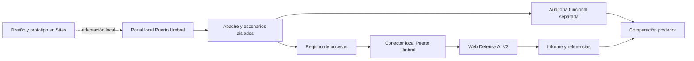

# PRD — Puerto Umbral

Versión del documento: 0.1 · Fecha: 26/10/2026 · Idioma: español.

Estado: concepto elegido por el propietario; requisitos propuestos para revisión.
Este documento define trabajo futuro. No acredita implementación, pruebas,
despliegue, integración con V2 ni resultados de detección.

Seguimiento posterior del 26/10: el propietario solicita iniciar el desarrollo.
El [registro F1](PUERTO_UMBRAL_F1_2026_10_26.md) documenta el prototipo privado
publicado, sus verificaciones y los componentes que siguen pendientes.
La [continuación F2/F3](PUERTO_UMBRAL_F2_F3_2026_10_26.md) registra el desarrollo
posterior y la decisión de aplazar pruebas automáticas para revisión manual.
La [preparación de Parrot](PUERTO_UMBRAL_PARROT_2026_10_26.md) adapta la distribución
a un laboratorio portable incluido en V2 y documenta el nuevo arranque conjunto.

## 1. Producto y propósito

Puerto Umbral será una aplicación de laboratorio ambientada en una estación
logística orbital. Sus funciones de mercancías, comunicaciones, archivos,
mantenimiento y acceso de tripulación permitirán ejecutar pruebas de seguridad
sobre datos ficticios y contrastar sus evidencias con Web Defense AI V2.

El usuario recorrerá una web con identidad propia, realizará una acción normal
o un intento de ataque, observará su efecto y comprobará qué puede detectar V2.
La unidad de valor será una ejecución reproducible con petición, resultado real,
evidencia capturada y conclusión defensiva diferenciados.

### Objetivos

- Disponer de un sitio original con varias superficies de ataque coherentes.
- Ejecutar pruebas reales contra componentes propios y aislados del laboratorio.
- Comparar el comportamiento vulnerable y corregido de cada función.
- Incorporar una fuente Puerto Umbral a V2 sin sustituir DVWA ni sus datos.
- Seguir la llegada de eventos nuevos y analizar sus indicadores con trazabilidad.
- Evaluar aciertos, omisiones y falsas alarmas sobre un corpus definido.
- Ampliar progresivamente la cobertura de riesgos de OWASP según la evidencia.

### Fuera del alcance inicial

Ataques contra terceros; selección de destinos arbitrarios; denegación de
servicio; malware; persistencia; extracción de datos reales; exposición pública
del backend vulnerable; multiusuario público; certificación de seguridad;
cobertura universal de OWASP; modificación del laboratorio DVWA existente.

Las notificaciones externas, los análisis LLM programados, una instalación en
Parrot y cualquier publicación serán actuaciones posteriores con alcance propio.
La petición de este PRD no inicia esas operaciones.

## 2. Usuarios y recorridos

| Usuario | Necesidad | Recorrido principal |
| --- | --- | --- |
| Propietario del laboratorio | Probar una vulnerabilidad y verificar la observación defensiva | Preparar escenario → ejecutar → capturar → analizar → comparar |
| Alumno o analista | Comprender por qué una petición resulta sospechosa | Leer objetivo → probar → inspeccionar evidencia → consultar explicación |
| Mantenedor de V2 | Evaluar cambios sin perder la referencia anterior | Repetir corpus versionado → comparar métricas → revisar regresiones |

### Historias de usuario

- HU-01: como operador, quiero entrar en una estación creíble y usar sus funciones
  normales antes de atacar, para disponer de tráfico benigno de referencia.
- HU-02: quiero seleccionar un escenario y conocer su objetivo, sus límites y
  qué evidencias puede producir, sin recibir una promesa de detección.
- HU-03: quiero repetir la misma prueba en modo vulnerable y corregido para
  comprobar el efecto del control y los indicadores que permanecen visibles.
- HU-04: quiero usar formularios o un proxy de pruebas contra el destino local
  permitido, sin depender exclusivamente de botones predefinidos.
- HU-05: quiero ver si el log está actualizado y solicitar un análisis de V2
  cuando haya evidencia nueva.
- HU-06: quiero distinguir intento, efecto demostrado y hallazgo del detector.
- HU-07: quiero detener el seguimiento y restablecer un escenario conservando
  sus evidencias anteriores.

## 3. Experiencia y diseño

### Identidad visual

Portal industrial espacial: fondos oscuros, superficies legibles, acentos cian,
avisos ámbar, tipografía técnica y un plano de muelles. La información operativa
debe seguir siendo comprensible sin animaciones ni conocimiento del relato.
Los estados incluyen texto e iconos; el color no será su único indicador.

### Áreas del producto

| Área | Contenido y acciones |
| --- | --- |
| Centro de operaciones | Mapa de muelles, actividad ficticia, accesos a módulos y estado del laboratorio |
| Mercancías | Búsquedas, filtros y ficha de una carga |
| Comunicaciones | Consulta de mensajes y búsqueda de avisos |
| Archivo de vuelo | Listado y descarga de documentos ficticios |
| Mantenimiento | Diagnóstico acotado de un componente del laboratorio |
| Tripulación | Acceso de cuentas ficticias y área de usuario |
| Panel de laboratorio | Escenarios, modos, límites, ejecución, detención y restablecimiento |
| Evidencias y comparación | Peticiones, efectos reales, estado de captura y referencias a resultados V2 |

El portal vulnerable y el panel de control usarán orígenes y credenciales
separados. Un XSS del escenario no debe obtener acceso al panel de control,
a V2 ni a los controles de restablecimiento.

### Modos de uso

1. **Exploración:** navegación normal, sin generar ataques automáticamente.
2. **Prueba guiada:** objetivo, acción acotada, resultado observado y explicación.
3. **Prueba manual:** interacción libre dentro del destino permitido mediante
   navegador o proxy; registro de límites y procedencia de la sesión.
4. **Misión:** secuencia de escenarios con objetivos encadenados; posterior al MVP.

Cada escenario mostrará su estado: disponible, ejecutándose, completado,
detenido o fallido. El resultado funcional se registra por separado como
efecto demostrado, bloqueado o indeterminado. Un fallo de ejecución no equivale
a protección correcta y una respuesta HTTP 200 no demuestra explotación.

## 4. Alcance de la primera entrega

El MVP comprende las fases F0–F5: diseño con Sites, laboratorio local de cinco
familias, conector V2, seguimiento acotado y validación de la entrega.

| ID | Módulo | Escenario MVP | Modo vulnerable | Modo corregido | Observación inicial en V2 |
| --- | --- | --- | --- | --- | --- |
| PU-S01 | Mercancías | SQLi en consulta GET | Consulta insegura sobre datos ficticios permite resultados no previstos | Consulta parametrizada conserva la funcionalidad normal | Indicadores presentes en la URL; no demuestra por sí solo lectura indebida |
| PU-S02 | Comunicaciones | XSS reflejado | La entrada alcanza un contexto ejecutable en el origen del escenario | Codificación contextual impide la ejecución | Indicadores en la URL; ejecución verificada por el laboratorio |
| PU-S03 | Archivo | Traversal | Se alcanza un documento señuelo fuera de la carpeta funcional autorizada | Resolución de rutas y autorización impiden el acceso | Secuencias de traversal observables; acceso real comprobado aparte |
| PU-S04 | Mantenimiento | Inyección de comandos | Un proceso desechable confinado produce un marcador inocuo | Separación de argumentos y validación impiden la inyección | Indicadores en la URL; sin inferir ejecución desde el log |
| PU-S05 | Tripulación | Ráfaga de autenticación | El acceso ficticio carece del control de intentos del escenario | Limitación temporal y controles de autenticación | Ráfaga de envíos; el log de accesos no demuestra credenciales ni éxito |

En PU-S03, el documento señuelo estará dentro del almacenamiento desechable del
escenario; no habrá acceso al sistema de archivos del equipo. En PU-S04, el
proceso vulnerable será no privilegiado, sin red, sin montajes del host y con
límites de recursos y tiempo. No se expondrá una terminal de propósito general.

Cada familia tendrá tres variantes documentadas y acciones benignas comparables.
Las variantes se fijarán antes de medir resultados y no se elegirán únicamente
porque coincidan con las expresiones del detector. Las limitaciones observadas
se conservarán en la evaluación.

El XSS almacenado se aplaza a F6. El MVP no intentará recuperar cuerpos POST
ausentes ni introducir contraseñas en la URL para hacerlas visibles al detector.

## 5. Relación con OWASP

La referencia de clasificación será [OWASP Top 10:2025](https://top10.owasp.org/2025/).
Los casos de prueba usarán referencias versionadas de
[WSTG 4.2](https://wstg.owasp.org/v4.2/) para evitar cambios silenciosos de la
guía. La correspondencia de cada escenario se documentará en F0 y F6.

| Categoría 2025 | Aplicación a Puerto Umbral | Entrega y evidencia necesaria |
| --- | --- | --- |
| A01 — Control de acceso | Traversal, IDOR, CSRF y SSRF | Traversal en MVP; resto F6 con identidad, recursos, autorización y/o trazas del señuelo |
| A02 — Configuración de seguridad | Configuración insegura de una réplica aislada | F7; comparación de configuración y respuestas |
| A03 — Cadena de suministro | Dependencia o artefacto de procedencia no verificada | F7; manifiestos y verificación de procedencia; sin instalar malware |
| A04 — Criptografía | Protección incorrecta de datos ficticios | F7; revisión de configuración y artefactos de prueba |
| A05 — Inyección | SQLi, XSS y comandos | MVP; peticiones más comprobación funcional independiente |
| A06 — Diseño inseguro | Saltarse una aprobación o reutilizar un permiso | F6; eventos de negocio y estado del flujo |
| A07 — Autenticación | Intentos repetidos y controles del acceso | MVP; ráfagas y resultado de autenticación en auditoría separada |
| A08 — Integridad de software o datos | Manifiesto de carga manipulado | F7; firmas o comprobaciones de integridad sobre archivos ficticios |
| A09 — Registro y alertas | Captura ausente, pérdida de eventos y avisos no visibles | F4–F5; salud, secuencias y pruebas del seguimiento local |
| A10 — Condiciones excepcionales | Fallos controlados y tratamiento de errores | F7; errores acotados, recuperación y registros |

Esta matriz es una propuesta de cobertura educativa. Un módulo no certifica
toda una categoría y algunos ejercicios de F7 serán revisión de evidencias o
simulación declarada. La interfaz distinguirá prueba real, simulación y revisión.
OWASP incluye SSRF y CSRF en
[A01:2025](https://top10.owasp.org/2025/A01_2025-Broken_Access_Control/).

## 6. Arquitectura propuesta y papel de Sites

### Dos entornos con responsabilidades distintas

**Sites:** diseño visual y prototipo interactivo privado para revisar pantallas,
navegación, escenarios y estados. Sus datos de demostración llevarán una
indicación visible. El prototipo alojado no ejecutará vulnerabilidades contra
la infraestructura de Sites ni requerirá acceso remoto al equipo del usuario.

**Laboratorio local:** portal funcional vulnerable/corregido, panel de control,
datos sintéticos, generador de pruebas y registros. El diseño revisado en Sites
se trasladará a una interfaz local. F0 comprobará la portabilidad del código y
definirá qué piezas requieren adaptación; no se presupone un traslado automático.

Web Defense AI V2 seguirá siendo el analizador defensivo. El comparador leerá
sus resultados y las evidencias del laboratorio después del análisis; no
inyectará las respuestas esperadas en el contexto del detector.

### Elecciones técnicas propuestas

- Apache como entrada del laboratorio y productor de un formato compatible con
  el parser actual de V2; las peticiones pasarán realmente por él.
- Backend ligero en Python y SQLite para datos ficticios, sujeto al diseño F0.
- Contenedores separados para las superficies que requieran mayor confinamiento.
- Procesos de control y observación fuera de los componentes vulnerables.
- Servicios en loopback del equipo del laboratorio y red interna para los
  componentes. Propuesta de puertos: portal 4380 y panel 4381, sujetos a preflight.
- Ningún acceso remoto desde Sites hacia la VM ni túnel público como requisito.
- Repositorio propio para el producto Puerto Umbral cuando empiece el desarrollo;
  este PRD reside en V2 como documento de integración. No se crea repositorio ahora.

La primera plataforma operativa objetivo será Linux/Parrot. Windows con Docker
Desktop será una ampliación hasta que exista comprobación propia. Preparar
archivos en Windows no acredita una instalación en Parrot.

## 7. Punto de partida real de V2

Revisión de código local realizada para este PRD el 26/10/2026:

| Capacidad actual | Consecuencia para el diseño |
| --- | --- |
| [Preparación](../agents/evidence_preparation.py) con cinco familias de indicadores | Reutilizar el alcance existente sin prometer detección universal |
| [Contrato](../agents/evidence_contracts.py) basado en líneas de access.log | Preservar originales, números de línea, hash y limitaciones de la muestra |
| Indicadores buscados en el target decodificado | Cuerpos POST y eventos de negocio requieren fuentes y contratos adicionales |
| Ráfagas asociadas a rutas concretas de login | Validar una ruta compatible o adaptar explícitamente el reconocimiento |
| [Capturador DVWA](../dashboard/services/dvwa_lab_capture.py) con contenedor fijo | Crear un conector independiente; no renombrar ni reapuntar el capturador DVWA |
| [Perfiles locales](../scripts/local_runtime_profile.py) legacy/pilot | Incorporar perfil Puerto Umbral y sus rutas; no basta cambiar LOG_PATH |
| [Pipeline](../pipeline.py) con fuentes de sincronización enumeradas | Añadir fuente y validación explícitas para Puerto Umbral |
| Perfil manual con worker separado | Mantener captura, lectura, cola y análisis como operaciones diferenciadas |

Los valores predeterminados actuales de preparación exploran una ventana de
100 líneas y seleccionan hasta 30 evidencias. El corpus debe respetar o medir
esos límites; la actividad omitida no puede presentarse como analizada.

## 8. Requisitos funcionales

P0: necesario para MVP. P1: ampliación F6. P2: ampliación F7.

| ID | Prioridad | Requisito verificable |
| --- | --- | --- |
| RF-01 | P0 | Navegar las cinco áreas funcionales y generar tráfico benigno real |
| RF-02 | P0 | Elegir escenario, consultar objetivo, límites y evidencia esperada |
| RF-03 | P0 | Seleccionar modo vulnerable/corregido antes de iniciar la ejecución |
| RF-04 | P0 | Ejecutar los cinco escenarios MVP sobre datos y procesos del laboratorio |
| RF-05 | P0 | Admitir interacción manual contra el origen local permitido |
| RF-06 | P0 | Restablecer exclusivamente los datos del escenario seleccionado |
| RF-07 | P0 | Registrar petición, tiempo, resultado funcional y estado de ejecución |
| RF-08 | P0 | Capturar accesos reales en un origen Puerto Umbral independiente |
| RF-09 | P0 | Mostrar estado de fuente, última captura, errores y evidencia nueva |
| RF-10 | P0 | Solicitar análisis manual con estado y referencia al trabajo V2 |
| RF-11 | P0 | Activar, pausar y detener seguimiento sin perder evidencia anterior |
| RF-12 | P0 | Comparar por separado indicador V2 y efecto observado en el laboratorio |
| RF-13 | P0 | Exportar el recibo de ejecución y las referencias a sus evidencias |
| RF-14 | P0 | Incorporar tráfico benigno y pruebas bloqueadas a la evaluación |
| RF-15 | P0 | Mostrar huecos de captura, omisiones y estado indeterminado |
| RF-16 | P0 | Mantener historial de ejecuciones aunque cambien los datos del escenario |
| RF-17 | P1 | Añadir XSS almacenado, IDOR, CSRF, SSRF y lógica de negocio |
| RF-18 | P1 | Correlacionar eventos de aplicación con accesos sin revelar respuestas esperadas |
| RF-19 | P1 | Ofrecer misiones de varios pasos con resultado por etapa |
| RF-20 | P2 | Incorporar ejercicios de las categorías OWASP restantes con tipo de evidencia visible |

## 9. Evidencias, datos y evaluación

### Registros separados

1. **Accesos:** líneas compatibles con Apache, con método, target, fecha,
   origen observado y estado. No se inventarán líneas para afirmar que hubo tráfico.
2. **Auditoría del escenario:** efecto funcional real, recurso ficticio afectado
   y versión del componente; quedará fuera de la entrada inicial del detector.
3. **Recibo de ejecución:** identificador de ejecución, escenario, variante,
   modo, semilla de datos, versiones, tiempos, límites y referencias por hash.
4. **Salida V2:** trabajo, analysis_id, generación publicada, evidencias citadas
   y clasificación. Un análisis fallido no se registrará como detección negativa.
5. **Evaluación posterior:** expectativas declaradas, correspondencias y métricas.

El log que recibe V2 no incluirá nombres de ataque, modo del escenario,
veredicto esperado ni etiquetas de evaluación. Un request_id opaco puede servir
para correlación mediante un índice externo, sin alterar la petición original
ni depender de que el contrato V2 actual lo interprete.

Las rutas locales propuestas, todavía inexistentes, son:

- Laboratorio: almacenamiento propio por ejecución para datos y auditoría.
- V2: `.local-state/puerto-umbral/access.log`, `reports/` y `analysis.sqlite3`
  dentro del nuevo espacio `.local-state/puerto-umbral/`.
- Índices y recibos: subdirectorios del mismo perfil, separados del log de entrada.

La implementación fijará nombres finales sin sobrescribir pilot, legacy,
respaldos o publicaciones anteriores. No se mezclarán líneas JSON de auditoría
con el access.log ni se importará un formato nuevo como si el parser lo admitiera.

### Resultados que deben distinguirse

- Petición enviada frente a petición recibida y registrada.
- Patrón observado frente a intento clasificado.
- Intento bloqueado frente a efecto funcional demostrado.
- Evidencia disponible frente a evidencia incluida en la muestra analizada.
- Ausencia de hallazgos frente a fuente vacía, antigua, incompleta o con error.

### Corpus mínimo y medición

El corpus MVP tendrá 45 casos definidos antes de evaluar: cinco familias por
tres variantes por dos modos = 30 casos con intento, más 15 casos benignos.
Las ráfagas cuentan como un caso con varias peticiones; se registrará el total
de peticiones y no se confundirá con el número de casos o grupos V2.

Un intento bloqueado sigue siendo un caso positivo para detectar intentos.
Los indicadores no deben desaparecer artificialmente para lograr un resultado
negativo en el modo corregido. El control se evalúa por su efecto funcional.

El ensayo determinista de captura, parseo y puntuación se separará del ensayo
del LLM. Reproducir los 45 casos no autoriza 45 llamadas ni análisis LLM. El plan
de ejecuciones reales fijará lotes, proveedor, modelo, presupuesto y número de
repeticiones antes de usar el proveedor.

Se publicarán, con denominadores, por familia y globales:

- Casos ejecutados, fallidos, indeterminados y no evaluables.
- Peticiones capturadas, omitidas, duplicadas y fuera de ventana.
- Precisión y recuperación para intentos, más falsas alarmas en tráfico benigno.
- Efectos demostrados y bloqueados por modo, según auditoría independiente.
- Tiempo hasta captura y, por separado, cola, análisis y publicación.
- Uso del modelo y coste observado cuando exista evidencia del proveedor.

Umbral propuesto para aceptar la detección en este corpus: al menos 27/30 casos
con intento identificados, al menos 5/6 por familia y cero falsas alarmas en los
15 casos benignos. Son objetivos pendientes de medir, no resultados existentes
ni garantía estadística. Si no se cumplen, se registra el fallo y su tratamiento
o una decisión expresa de alcance; no se cambian expectativas después de medir.

## 10. Monitorización y operación

### Modos del nuevo perfil

| Modo | Comportamiento |
| --- | --- |
| Lectura | Consulta el último estado local, sin capturar ni analizar |
| Captura manual | Obtiene un snapshot validado del origen permitido |
| Seguimiento | Comprueba nuevas líneas a intervalos; actualiza captura y salud local |
| Análisis manual | Encola una solicitud explícita para la evidencia seleccionada |
| Análisis periódico | Ampliación opcional con activación y presupuesto explícitos; desactivada por defecto |

Propuesta inicial de seguimiento: intervalo de cinco segundos, un ciclo activo,
sesión máxima predeterminada de treinta minutos y pausa/detención visibles.
El usuario podrá iniciar otra sesión; cerrar la interfaz no dejará un bucle
indefinido sin un proceso y estado documentados. F4 decidirá el comportamiento
exacto ante pérdida de la interfaz y parada del proceso supervisor.

No se llamará al LLM por cada petición. Sin cambios de contenido no habrá un
nuevo trabajo; la idempotencia y exclusión impedirán duplicados y solapamientos.
La ingesta no competiría con la sincronización del worker: una sola autoridad
gestionará el snapshot y cada trabajo consumirá una versión inmutable identificada.

La monitorización mostrará fuente desconectada, captura atrasada, seguimiento
pausado y análisis fallido como estados distintos. Ante error se conservará el
último snapshot válido y su fecha, sin presentarlo como evidencia nueva.

Se contemplarán rotación, truncado, reinicio del contenedor, líneas incompletas
y desajustes de reloj. Se mantendrá la IP observada, sin inventar IPs distintas
para simular atacantes ni confiar en cabeceras de origen aportadas por el cliente.

## 11. Requisitos no funcionales

| ID | Requisito | Comprobación prevista |
| --- | --- | --- |
| RNF-01 | Aislamiento del host, V2, DVWA y servicios externos | Redes, montajes, permisos y pruebas negativas del confinamiento |
| RNF-02 | Control separado de la superficie vulnerable | Orígenes diferentes; ausencia de tokens de control en el portal |
| RNF-03 | Datos exclusivamente ficticios en escenarios | Inventario de semillas y revisión de artefactos exportables |
| RNF-04 | Límites por ejecución | Máximo propuesto: 20 peticiones, dos por segundo y 30 segundos; exceso rechazado; la ráfaga debe caber dentro del límite |
| RNF-05 | Integridad y recuperación de evidencias | Escritura atómica, hashes, límites de entrada y conservación ante fallo |
| RNF-06 | Reproducibilidad | Versiones fijadas, semilla registrada y comparación antes/después |
| RNF-07 | Lectura accesible | Teclado, foco visible, etiquetas, contraste y estados con texto |
| RNF-08 | Interfaz adaptable | Verificación en anchuras 390, 768 y 1440 px, sin pérdida de acciones |
| RNF-09 | Rendimiento local acotado | Objetivo: captura visible en diez segundos en 20 ciclos, con hardware y carga registrados; LLM medido aparte |
| RNF-10 | Datos de operación fuera del repositorio | Logs, SQLite, recibos y secretos excluidos del control de versiones |
| RNF-11 | Parada y restablecimiento acotados | Detener solo procesos propios; restablecer solo datos del escenario; sin borrar evidencias |
| RNF-12 | Tratamiento seguro de contenido hostil | Logs e informes como texto; sin interpolar contenido en comandos ni instrucciones del control o evaluador |

Los límites de RNF-04 son valores propuestos para los controles integrados del
laboratorio. Las pruebas manuales tendrán también límites en el servidor; no
bastará una restricción del botón. El confinamiento de red y procesos seguirá
activo en ambos modos: corregir o debilitar un escenario no debilita el perímetro.

## 12. Fases, entregables y criterios de salida

La división describe dependencias y resultados revisables. El estado de ejecución
posterior se recoge en el registro de seguimiento enlazado al inicio; este PRD
no constituye por sí solo una orden de ejecutar operaciones.

### F0 — Especificación y contrato del laboratorio

**Objetivo:** convertir este PRD en un alcance implementable sin ambigüedades.

Trabajo:

- Revisar requisitos, cinco escenarios y matriz de cobertura.
- Definir topología, puertos, recursos, aislamiento de orígenes y datos.
- Comprobar portabilidad entre el diseño Sites y la interfaz local.
- Fijar catálogo de variantes, corpus, campos y correlación de evidencias.
- Acordar límites, decisiones de almacenamiento y plan de presupuesto LLM futuro.

Entregables: PRD revisado, esquema de arquitectura, fichas de cinco escenarios,
contrato de evidencia y backlog priorizado. Dependencia: ninguna.

Criterios de salida:

- F0-AC1: cada escenario define entrada, efecto verificable, corrección y límite.
- F0-AC2: queda resuelta la separación Sites/laboratorio/V2 y el manejo de XSS.
- F0-AC3: el corpus y sus expectativas se versionan antes de medir detección.

### F1 — Diseño y prototipo en Sites

**Objetivo:** revisar la identidad visual y los recorridos antes del backend.

Trabajo: diseñar centro de operaciones, módulos, panel de laboratorio y
comparador; implementar navegación y estados con datos de demostración;
revisar pantallas y adaptar el diseño según observaciones.

Entregables: prototipo Sites privado, mapa de pantallas y decisiones visuales.
Dependencia: F0. La publicación del prototipo será una operación futura dentro
del encargo de implementación, no parte de este PRD.

Criterios de salida:

- F1-AC1: se puede recorrer selección → prueba demostrada → evidencia → comparación.
- F1-AC2: toda simulación está identificada y ningún botón afirma ejecutar un ataque real.
- F1-AC3: diseño revisado por el propietario, incluyendo móvil y teclado.

### F2 — Laboratorio funcional de cinco escenarios

**Objetivo:** ejecutar pruebas reales en el entorno local aislado.

Trabajo: trasladar la interfaz; preparar Apache, backend, datos y componentes
confinados; implementar PU-S01–05 y sus modos; añadir controles del servidor,
parada y restablecimiento; generar auditoría funcional independiente.

Entregables: laboratorio local, semillas, fichas de ejecución y pruebas de
aislamiento. Dependencia: F1 y contratos F0.

Criterios de salida:

- F2-AC1: los cinco escenarios producen un efecto demostrable en modo vulnerable
  y lo impiden en modo corregido sin romper el uso benigno previsto.
- F2-AC2: el efecto se demuestra con auditoría o marcador inocuo, no solo con HTTP 200.
- F2-AC3: restablecer un escenario conserva evidencias y no modifica DVWA ni V2.
- F2-AC4: XSS, traversal y comandos permanecen dentro de sus límites verificados.

### F3 — Integración manual con Web Defense AI V2

**Objetivo:** completar el recorrido de una petición real hasta un informe V2.

Trabajo: nuevo perfil y capturador Puerto Umbral; fuente explícita del pipeline;
snapshots verificables; reconocimiento de login; vista de estado de fuente;
solicitud manual y enlace a evidencias/publicación.

Entregables: conector, perfil aislado, guía de configuración y recibo de un
recorrido completo. Dependencia: F2. Las llamadas reales al modelo requieren
el alcance y presupuesto de ejecución fijados para ese ensayo.

Criterios de salida:

- F3-AC1: una petición enviada aparece en el snapshot y conserva su línea y hash.
- F3-AC2: un trabajo consume un snapshot identificado y publica referencias válidas.
- F3-AC3: fuente ausente, corrupta o atrasada no aparece como «sin ataques».
- F3-AC4: pilot y legacy conservan su comportamiento y sus datos.

### F4 — Seguimiento de logs y control operativo

**Objetivo:** mantener actualizada la evidencia sin consumo LLM automático.

Trabajo: sesión de seguimiento acotada, detección de cambios, checkpoints,
rotación/truncado, estados de salud, exclusión con el worker e idempotencia.
Implementar pausa y detención, con indicación del último ciclo válido.

Entregables: seguimiento local y guía de operación/parada. Dependencia: F3.

Criterios de salida:

- F4-AC1: veinte ciclos observados cumplen el objetivo local de diez segundos,
  o se documenta y revisa una desviación con condiciones del ensayo.
- F4-AC2: sin cambios no se duplican eventos ni se crean trabajos nuevos.
- F4-AC3: desconexión, rotación y reinicio tienen estado visible y conservan evidencia.
- F4-AC4: pausar/detener impide nuevos ciclos y no deja procesos propios huérfanos.
- F4-AC5: seguir logs no llama al LLM ni envía notificaciones.

### F5 — Evaluación, documentación y entrega MVP

**Objetivo:** entregar una primera versión local medible y reproducible.

Trabajo: ejecutar los 45 casos de captura y funcionamiento; realizar únicamente
los análisis LLM contemplados en el presupuesto del ensayo; puntuar resultados;
revisar errores, accesibilidad y confinamiento; documentar instalación,
recuperación, uso, parada y limitaciones.

Entregables: informe de evaluación con resultados brutos, métricas, corpus,
manual y lista de comprobación de la entrega. Dependencia: F4.

Criterios de salida:

- F5-AC1: los 45 casos tienen resultado y evidencia o causa explícita de fallo.
- F5-AC2: se cumplen los objetivos de detección del apartado 9 o existe una
  decisión expresa de alcance sobre los resultados inferiores; no aceptación por silencio.
- F5-AC3: cada conclusión distingue intento, bloqueo, efecto y evidencia insuficiente.
- F5-AC4: instalación y cierre se acreditan en la plataforma objetivo; otras
  plataformas siguen identificadas como no verificadas.
- F5-AC5: se conservan originales, presupuesto consumido y límites observados.

Hito: **MVP local Puerto Umbral integrado con V2**. No implica publicación
pública, nueva release de V2 ni cobertura completa de OWASP.

### F6 — Escenarios avanzados y nuevas fuentes

**Objetivo:** abordar ataques que requieren estado e identidad de aplicación.

Trabajo: XSS almacenado, IDOR, CSRF, SSRF contra un señuelo interno y permisos
de atraque con lógica de negocio. Diseñar contrato versionado de auditoría,
redacción de campos, correlación y nuevas reglas/contratos del detector.
Incorporar misiones después de validar sus escenarios individuales.

Entregables: módulos avanzados, contrato de eventos, ampliación V2 y corpus
adicional separado. Dependencia: MVP F5.

Criterios de salida:

- F6-AC1: acceso indebido se demuestra con identidad, recurso y política esperada.
- F6-AC2: SSRF queda limitada al señuelo sin salida al host ni a Internet.
- F6-AC3: CSRF se prueba entre orígenes del laboratorio, sin afectar al control.
- F6-AC4: el detector no recibe las etiquetas ni veredictos esperados del evaluador.
- F6-AC5: toda ampliación tiene positivos, negativos y regresión del MVP.

### F7 — Cobertura educativa ampliada de OWASP

**Objetivo:** completar el mapa de categorías con evidencias apropiadas.

Trabajo: ejercicios de configuración, cadena de suministro, criptografía,
integridad y condiciones excepcionales; fallo controlado de captura y avisos;
explicaciones de qué puede y qué no puede observar V2.

Entregables: catálogo OWASP, ejercicios y matriz final de cobertura, distinguiendo
pruebas reales, simulaciones y revisiones. Dependencia: F6 para reutilizar fuentes.

Criterios de salida:

- F7-AC1: cada categoría tiene un objetivo educativo y tipo de evidencia explícitos.
- F7-AC2: ninguna simulación ni revisión se presenta como explotación real.
- F7-AC3: ninguna categoría figura como detectada por V2 sin regla, evidencia
  y resultado de evaluación propios.

### Secuencia de hitos

| Hito | Fases | Resultado |
| --- | --- | --- |
| H0 | F0 | Alcance y contratos revisables |
| H1 | F1 | Diseño navegable aprobado |
| H2 | F2 | Cinco escenarios reales aislados |
| H3 | F3–F4 | Captura, análisis manual y seguimiento local |
| H4 | F5 | MVP evaluado y documentado |
| H5 | F6 | Estado de aplicación y ataques avanzados |
| H6 | F7 | Catálogo educativo OWASP ampliado |

No se fijan fechas de entrega ni costes de infraestructura/modelo sin resolver
las decisiones F0 y medir las primeras integraciones. Las fases no reabren los
cierres históricos C1–C4/V1 de V2.

## 13. Riesgos y tratamiento previsto

| Riesgo | Tratamiento y comprobación |
| --- | --- |
| Confundir maqueta con laboratorio real | Etiquetar demostraciones y separar entornos, URLs y resultados |
| Sites no admite el backend requerido | Reservar Sites a diseño; validar traslado local en F0 |
| V2 reconoce patrones pero no efectos | Comparador con auditoría independiente y lenguaje limitado a evidencia |
| Ajustar los ataques a las reglas para aparentar cobertura | Variantes fijadas antes del ensayo y casos disconformes conservados |
| Eventos perdidos por ventana o rotación | Checkpoints, snapshots inmutables y omisiones contabilizadas |
| XSS afecta a los controles | Orígenes separados y ausencia de credenciales compartidas |
| Comandos o traversal alcanzan el equipo | Procesos desechables, almacenamiento señuelo y pruebas negativas |
| Datos contaminan instrucciones o salida del evaluador | Tratar payloads/logs como datos hostiles y renderizarlos como texto |
| Consumo LLM repetido | Activación explícita, presupuesto, hash del snapshot y exclusión de trabajos |
| Nuevo perfil sobrescribe laboratorio previo | Rutas propias, pruebas de regresión y snapshots de referencia |
| La captura contiene secretos o contenido innecesario | Excluir credenciales; auditoría con campos permitidos y redacción |

## 14. Decisiones que resolverá F0

| Decisión | Propuesta inicial | Motivo |
| --- | --- | --- |
| D-01 — Ubicación del producto | Repositorio independiente Puerto Umbral | Separar la aplicación vulnerable del analizador |
| D-02 — Plataforma operativa | Linux/Parrot local | Encaja con el laboratorio del propietario; verificar capacidades reales |
| D-03 — Sites | Prototipo privado con datos de demostración | Revisar diseño sin desplegar vulnerabilidades |
| D-04 — Stack del laboratorio | Apache, backend Python, SQLite y contenedores confinados | Compatibilidad inicial con evidencias V2 y datos reproducibles |
| D-05 — Seguimiento | Cinco segundos, sesión de treinta minutos, LLM manual | Actualidad de evidencias con consumo controlado |
| D-06 — Captura de cuerpos | Excluida del MVP; contrato específico en F6 | El parser actual no la garantiza; evitar registrar credenciales |
| D-07 — Presupuesto de evaluación | Definir antes de cualquier análisis real | Separar generación/captura de casos del coste del proveedor |
| D-08 — Conservación | Evidencias persistentes hasta limpieza explícita; límite de disco que pausa nuevas ejecuciones | Evitar borrado silencioso o crecimiento sin control; fijar cuota en F0 |

Estas propuestas sirven como base de implementación y pueden ajustarse durante
la revisión del PRD. No se han aplicado configuraciones ni creado recursos.

## 15. Referencias y conservación del alcance

- [OWASP Top 10:2025](https://top10.owasp.org/2025/): clasificación de riesgos.
- [OWASP WSTG 4.2](https://wstg.owasp.org/v4.2/): referencia versionada de pruebas.
- [OWASP A09:2025](https://top10.owasp.org/2025/A09_2025-Security_Logging_and_Alerting_Failures/): registro, monitorización y alertas.
- [README V2](../README.md): capacidades y límites de la entrega actual.
- [Instalación y operación V2](INSTALACION_AUTOALOJADA.md): perfiles y análisis manual.
- [Laboratorio DVWA](LABORATORIO_DVWA_FASE_6.md): entorno existente que debe conservarse.
- [Plan histórico y estado V2](PLAN_AGENTES_TAREAS.md): cierres existentes independientes.

La elaboración de este documento no cambia código, dependencias, configuraciones,
secretos, datos operativos ni estados de entrega. No inicia servicios, Docker,
pruebas de ataque, llamadas LLM, avisos o acciones sobre la VM. El documento queda
local para revisión, sin commit, push ni publicación.
